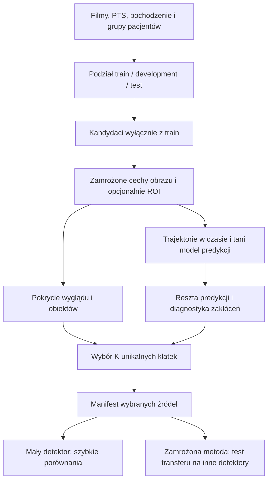

# 23 — Jak połączyć kurację wideo z projektem grantowym

Data: 2026-09-11. **Status: propozycja badania po lekturze dokumentów i wybranych fragmentów kodu; nie wynik treningu na wideo.** Plan szybkiego sprawdzania hipotezy: [24 — małe detektory i Eden](24_SZYBKIE_ABLACJE_I_OPTYMALIZACJA_EDEN.md). Audyt dotychczasowej pracy: [22](../22_AUDYT_LITERATURY_I_PLAN_PUBLIKACJI.md).

## 1. Rekomendacja

**Tak: projekt grantowy może dostarczyć metody mierzenia redundancji i zmian w czasie. Najpierw użyć jej jako selektora danych przed treningiem zwykłego detektora.** Zamrożone cechy obrazu → tani predyktor następnego stanu → pomiar błędu predykcji → wybór klatek przy zachowaniu pokrycia wyglądu, obiektów i nagrań. Wtedy można sprawdzić, czy sama selekcja poprawia detekcję, bez jednoczesnej zmiany architektury sieci.

Kandydat na tezę: **przy tym samym budżecie unikalnych klatek i treningu uwzględnienie przewidywalności zmian obiektu pomaga wybrać użyteczniejsze dane chirurgiczne niż selekcja wyłącznie według wyglądu lub odstępu czasu; zamrożony selektor przenosi się między detektorami.** To hipoteza. Nie zakładamy ani dużej poprawy, ani przewagi operatora liniowego nad prostą różnicą cech.

Najważniejszy wkład grantu nie polega na dołączeniu nazw Koopman, Langevin i JEPA do DINO/SAM. Polega na sprawdzeniu, **czy score selekcji mierzy zmianę zadania, błąd opisu dynamiki, czy tylko zakłócenie obrazu**. To daje konkretny mechanizm do sfalsyfikowania.

## 2. Co rzeczywiście już masz w grancie

Źródła poniżej są w `F:/Studia/MCHTR/Grant/Projekt`. Sprawdzono plany, wybrane syntezy, karty tez, fragmenty implementacji oraz dwa zapisane JSON-y wynikowe. Nie wykonano ponownie treningów, dowodów Lean ani pełnego audytu całego repozytorium. Zakres i hashe: [rejestr źródeł](evidence_grant_2026-09-11/zrodla_lokalne.json).

| Istniejący element | Stan odczytany w projekcie | Zastosowanie w kuracji |
|---|---|---|
| [Plan wideo–chirurgia](F:/Studia/MCHTR/Grant/Projekt/project/plan-wideo-robot-chirurgia-2026-08-07.md) | Kierunek długoterminowy: zamrożony V-JEPA, bilans pamięci, rozszerzanie stanu, później segmentacja i robotyka | Kuracja klatek może być wcześniejszym, mierzalnym zastosowaniem analizy trajektorii. Nie wymaga robota ani planowania akcji. |
| [D59 — bilans pamięci](F:/Studia/MCHTR/Grant/Projekt/Research/Tezy/tezy/D59.md) | Teza robocza; rozdziela pamięć, utratę informacji, wymuszenie, nieliniowość i kolor reszt | Sprawdzać, dlaczego predyktor uważa klatkę za zaskakującą. Duży błąd może wynikać ze zbyt ubogiego predyktora. |
| [Kod miar D59](F:/Studia/MCHTR/Grant/Projekt/experiments/D59_bilans_pamieci/miary.py) | NumPy, ridge, podział po seriach, modele z historią/wejściami, diagnostyka reszt | Dobry punkt wyjścia do małego modułu analizującego sekwencje embeddingów; wymaga adaptacji kontraktu i walidacji. |
| [D116 — adres i dynamika](F:/Studia/MCHTR/Grant/Projekt/Research/Tezy/tezy/D116.md) oraz [oczyszczanie latentu](F:/Studia/MCHTR/Grant/Projekt/experiments/favorita_tft_pelny/oczysc_latent.py) | Obserwacja z jednego wariantu TFT/Favorita: duża część wariancji jest statyczna | Sprawdzić, czy DINO grupuje głównie charakterystyczny wygląd operacji, a pomija małe zmiany narzędzia. Zachować osobne miary wyglądu i dynamiki. |
| [F23 — formalizacja](F:/Studia/MCHTR/Grant/Projekt/Research/Tezy/tezy/F23.md) | Karta opisuje dowody w określonych modelach matematycznych i otwarte ograniczenia | Uzasadnia pytanie o pamięć pominiętych zmiennych. Nie dowodzi zgodności rozkładu obrazów z założeniami ani poprawy AP po selekcji. |
| [E-AQ — rozszerzenie stanu](F:/Studia/MCHTR/Grant/Projekt/Research/Tezy/zadania/E-AQ.md) | W karcie nadal OTWARTE: mody pamięci jako dodatkowy stan | Opcja późniejsza: kilka opóźnień albo filtrów wykładniczych, jeśli predykcja jednokrokowa nie wystarcza. |
| [Plan faz chirurgicznych](F:/Studia/MCHTR/Grant/Projekt/experiments/wideo_fazy/PLAN.md) | Dokument deklaruje ZAPROJEKTOWANY; brak runów w jego opisie | Pomysły na kontrolę kolejności czasu i ocenę faz. Plan segmentacji nie jest gotowym wynikiem detekcji. |
| [Synteza SIGReg/Koopman/Langevin](F:/Studia/MCHTR/Grant/Projekt/Research/syntheses/sigreg_koopman_langevin_jak_polaczyc_2026-09-03.md) | Zapisuje także wyniki ujemne i błąd optymalizatora wymagający powtórki części wariantów | Argument za pomiarem na zamrożonym latencie przed dodawaniem nowej straty do sieci. |

### Ustalenia, które ograniczają interpretację

1. Hash JSON-u przypiętego do D116 zgadza się z kartą. Jednak JSON podaje **85 stanów**, a karta mówi o 84 klatkach; możliwe rozróżnienie stanów i przejść nie jest tam jasno wyjaśnione. Pole `udzial_zdjety=0.9226388806` dotyczy łącznego odjęcia dnia i serii (`odjeto=[dzien, seria]`), nie samej tożsamości. Przy tej ortogonalnej dekompozycji zbalansowanych danych wkład dnia wynosi około 0,1384%, wkład serii około 92,1255%, a reszta 7,7361%. Nie przenosić tabeli 92,26/0,14/7,60 do nowej publikacji bez uzgodnienia definicji.
2. To jest **udział wariancji, nie udział informacji**. Mała wariancja może kodować ważną końcówkę narzędzia. Nie wolno z tego wyprowadzać, że większość cech DINO jest zbędna.
3. Odczytany [JSON porównania TFT](F:/Studia/MCHTR/Grant/Projekt/outputs/favorita_tft_dwuliniowy/POROWNANIE.json) podaje dla `promo_minus_bezmod` średnią różnicę MAE na promocjach +0,06251, dodatnią we wszystkich trzech zapisanych ziarnach. W tym porównaniu wariant pogarsza tę metrykę. To nie jest test kuracji ani przegląd wszystkich nowszych eksperymentów, ale pokazuje, że bogatszy opis dynamiki nie gwarantuje lepszego zadania końcowego.
4. Starsza strona wiki F23 opisuje 41 twierdzeń, nowsza karta F23 — 214. Nie weryfikowano tych buildów. Cytując zakres formalny, wrócić do aktualnych źródeł dowodów; liczba twierdzeń nie jest argumentem za skutecznością selektora.
5. N10 używa mocnego zdania o braku odpowiedników. Jego status oznacza wynik określonego przeglądu, **nie dowód nieistnienia konkurencji**. Liczba wolnych modów również nie musi równać się liczbie faz zabiegu.

## 3. Konkretne połączenie z obecnym pipeline’em



**Pierwsza wersja:** użyć istniejących, poprawnie wyliczonych cech DINO. Nie trenować nowego JEPA. Obecność modelu temporalnego w selektorze nie wymaga modelu temporalnego przy inferencji detektora: detektor nadal widzi pojedynczy obraz.

**Druga wersja, jeśli pierwsza daje powtarzalny sygnał:** cechy obiektowe obok kontekstu. Dla już anotowanej puli ROI może pochodzić z GT train. Dla selekcji przed anotacją trzeba użyć propozycji niezależnego modelu i policzyć jego koszt; nie można potajemnie korzystać z pełnych anotacji kandydatów. SAM nie identyfikuje automatycznie końcówki, a średnia wszystkich masek może opisywać głównie tło.

**Dalsza opcja:** zamrożony V-JEPA jako alternatywny ekstraktor klipów. V-JEPA 2 jest źródłem reprezentacji wideo, nie gotowym detektorem bbox ani gotowym selektorem do tego zadania. Jednokrotny koszt ekstrakcji również wchodzi do kosztu metody. [Praca V-JEPA 2](https://arxiv.org/abs/2506.09985).

## 4. Minimalny selektor do sprawdzenia

### 4.1 Czas, cechy i predykcja

Niech `z(v,t)` oznacza cechy klatki lub jawnie zdefiniowanego klipu z nagrania `v`. Zegar to **czas PTS w sekundach**. Indeks warstwy transformera i numer epoki treningu to inne osie i nie służą tutaj do estymacji dynamiki filmu.

Na train dopasować scaler i ewentualną projekcję, a następnie porównać:

```text
P0: z_hat(t) = z(t-1)                         # persistence / różnica cech
P1: z_hat(t) = A z(t-1) + b                   # ridge, liniowa dynamika
Pp: z_hat(t) = b + suma_j A_j z(t-j)          # krótka historia, opcjonalnie
r(t) = z(t) - z_hat(t)
```

Początkowo rząd historii 1; 2 lub 4 rozważać dopiero po diagnostyce. Wymiar projekcji np. 32 lub 64 jest parametrem pilota, nie wynikiem literaturowym. Podstawowy `A` to **aproksymacja liniowa na wybranych obserwablach**, a nie odzyskany prawdziwy operator fizyczny. Jeśli użyjemy wyłącznie PCA i ridge, tak właśnie opisać implementację.

Jednostkowy krok jest dopuszczalny tylko po ustaleniu równego odstępu czasowego kandydatów. Przy brakach i zmiennym FPS uwzględnić rzeczywiste odstępy albo podzielić film na ciągłe segmenty. Nie łączyć ostatniej klatki jednego pacjenta z pierwszą następnego. Przy klipach logować cały przedział kontekstu i zabezpieczyć granice podziałów.

### 4.2 Score: hipoteza użyteczności, nie miara informacji

Zacząć od `q(t)=||r(t)||²/d`. Osobna opcja to reszta normalizowana skalą współrzędnych oszacowaną na train lub shrinkage-Mahalanobis. Pełne wybielenie bez podłogi wariancji może wzmacniać szum w słabych kierunkach. Nie nazywać takiego score entropią, informacją wzajemną ani niepewnością epistemiczną bez dodatkowego modelu i walidacji.

**Kontrprzykład:** losowy błysk w tle może dać ogromną resztę i nie zawierać żadnej nowej informacji o narzędziu. Powoli poruszająca się, rzadka końcówka może mieć małą resztę, a być bardzo wartościowa dla detektora. Dlatego selektor nie powinien po prostu brać globalnego top-K największych błędów.

W pierwszym eksperymencie dopasowanie `A` na całym train jest dopuszczalną, tanią kuracją nienadzorowaną; trzeba ujawnić, że score jest wewnątrzpróbkowy. **Wiarygodność modelu dynamiki** mierzyć osobno na odłożonych operacjach w obrębie development. Mocniejszy wariant kuracji wykorzystuje 3-fold cross-fitting po operacjach *wewnątrz train*: także scaler/PCA i kalibracja reszt powstają w foldzie uczącym. Koszt dopasowania ridge jest zwykle mały względem ekstrakcji, lecz trzeba go zmierzyć.

Między foldami residuale mogą mieć inne skale. Kalibrację rankingową wykonać według jawnej reguły na danych dostępnych selektorowi; nie porównywać bezpośrednio przypadkowo różnych norm. Dobór rzędu i regularyzacji na tych samych foldach to development, a nie niezależny test.

### 4.3 Wybór klatek przy stałym K

Najprostszy interpretowalny wariant to **mieszanka pokrycia i niespodzianki czasowej**:

1. Przydzielić budżet między nagraniami jawną regułą, np. proporcjonalnie do liczby poprawnych kandydatów z ograniczeniem dominacji najdłuższych filmów. Zaokrąglenia i końcowe uzupełnienie muszą dawać dokładnie K.
2. Wybrać część budżetu metodą pokrycia cech, np. prawdziwy greedy k-center. Dla analizowanego wariantu naprawa zwracania rzeczywistych centrów jest warunkiem wstępnym z dokumentu 22.
3. Pozostałe miejsca wypełnić według `q(t)` z limitem skupiania wyborów w sąsiednich chwilach. Rzadkie zdarzenie może wymagać kilku sąsiednich klatek — odstęp minimalny jest parametrem, nie zasadą odrzucania wszystkich sąsiadów.
4. Zachować quota/obsługę negatywów oraz klatek statycznych. Nie usuwać rutynowo blur, odblasków i okluzji, bo stanowią realne warunki zadania.

Praktyczny pilot: udział reszt `alpha=0.25`, pozostałe 0.75 na pokrycie; to **propozycja startowa**, nie optymalna stała. Porównać `alpha=0` i `alpha=1` jako ablacje. Po pilocie zamrozić alpha przed testem. Wszystkie metody z tej rodziny mają takie same quota i reguły odstępu. Dodatkowe kontrolki `random-global` i `uniform-video` pozostają jawnie zdefiniowane, żeby nie przypisać działania quota samemu score.

Nie trzeba od razu składać D/E/S/F i nowych reszt w kolejny arbitralny ważony wektor. Najpierw ustalić, czy dodanie **jednego** sygnału temporalnego do stałego pokrycia daje korzyść. Dopiero później testować D/E/S/F jako osobną kontrolę historyczną.

## 5. Co przenieść z aparatu D59, a czego nie kopiować wprost

| Pomiar | Pytanie w kuracji | Ograniczenie |
|---|---|---|
| Ryzyko P0/P1/Pp na odłożonych operacjach | Czy model uczy się przewidywalności ponad powtarzanie poprzedniej klatki? Czy historia pomaga? | Niski MSE latentu nie oznacza lepszego AP. |
| Autokorelacja reszt, osobno dla ciągłych odcinków | Czy wysokie score wynikają z systematycznie pomijanej historii? | Brak korelacji liniowej nie dowodzi niezależności ani pełnego domknięcia nieliniowego. |
| Rozdzielenie stałego wyglądu i zmian | Czy score zdominowały pacjent, kamera i oświetlenie? | Średnia filmu jest estymatą wyglądu, nie udowodnioną funkcją własną. Może też zawierać informację o narzędziu. |
| Ruch, ranga, normy cech | Czy małe reszty wynikają z zaniku informacji lub prawie stałych cech? | Nie stanowią samodzielnego kryterium odrzucania ekstraktora. |
| Porównanie kilku opóźnień i rolloutów | Czy liniowa dynamika jest stabilna poza jednym krokiem? | Dla układu z wejściami trzeba propagować również wejścia; affine bias musi uczestniczyć w porównaniu. |
| Stratyfikacja score wg zakłóceń i zdarzeń | Czy reszty wskazują wejścia/wyjścia narzędzia, czy tylko jasność i ruch kamery? | Ręczna ocena na ustalonej próbce development; jej etykiety nie mogą stać się ukrytym testem do strojenia. |

**Konkretne pułapki implementacji do adaptacji:** `miary.py` zakłada tablicę `(S,T,d)` o wspólnej długości T; wideo potrzebuje masek lub list sekwencji o różnej długości. `kolor_W` liczy autokowariancję na sklejonych resztach, a komentarz uznaje szwy serii za pomijalne. Dla krótkich klipów należy liczyć wyłącznie poprawne pary w obrębie segmentu. `polgrupa_S` porównuje same macierze A i pomija affine bias. W `turniej/podmodel` reszta używa `Yte` bez odjęcia `my`, mimo centrowania celu train; przed użyciem jego MSE skorygować i sprawdzić ten kontrakt. Kowariancja reszt centruje średnią, więc ten ostatni fakt nie oznacza automatycznie takiego samego błędu wszystkich miar logdet.

Nie kopiować progów `3×podłoga`, `P_MAX=8`, `TAU_KOLOR=12` jako ustawień uzasadnionych dla chirurgii. Są częścią innego badania. Nie wymuszać z góry rozkładu OU/gaussowskiego na skokach, okluzjach i przejściach faz.

Książki o MSM i DMD są dobrym zapleczem dla modeli przejścia i diagnostyki. Nie uprawniają do nazwania minima gęstości potencjałem fizycznym. Czasy z `-dt/log(|lambda|)` wymagają m.in. sensownego, stabilnego modelu i `0<|lambda|<1`; fazy wartości zespolonych opisują również oscylacje. Cała operacja jest procesem niestacjonarnym, więc jeden globalny czas relaksacji nie wyznacza uniwersalnego FPS selekcji. [Bowman, Pande, Noé](https://link.springer.com/book/10.1007/978-94-007-7606-7), [Kutz i in.](https://doi.org/10.1137/1.9781611974508).

## 6. Jakie odpowiedniki trzeba uwzględnić

Wykorzystano zakończony wcześniej [przegląd Undermind dotyczący Koopmana i selekcji klatek](https://app.undermind.ai/projects/40294fa6-c9a3-4469-9a61-d3eddeaee893?path=%2Foperator%20Koopmana%20na%20latencie%20wideo%20jako%20kryterium%20selekcji%20klatek%20do%20treningu%20detektora): 139 wyników, w tej rundzie odczytano opis i pierwsze 18 rekordów. Dodatkowo narzędzie pełnotekstowe przeczytało Swift Sampling i KIDD; najważniejsze metadane i wybrane fragmenty sprawdzono w źródłach pierwotnych. Nie uruchamiano ponownie tego samego głębokiego przeglądu. Surowe odpowiedzi są w `evidence_grant_2026-09-11/`.

| Praca | Znaczenie i granica |
|---|---|
| [Swift Sampling, 2026](https://arxiv.org/abs/2605.22678) | Bardzo bliski odpowiednik **samego score**: przewidywanie cech przez rozwinięcie Taylora, norma reszty i lokalne maksima. Bada dobór wejściowych klatek dla Video-LLM, nie trening detektora końcówek. Porównanie z różnicą cech już istnieje. Adaptację do DINO i kuracji treningu oznaczyć jako adaptację; nie przejmować jego wyników QA jako dowodu wzrostu AP. |
| [KIDD, 2021](https://arxiv.org/abs/2110.00547) i [Comas i in., L4DC 2023](https://proceedings.mlr.press/v211/comas23a.html) | Rozdzielenie wyglądu obiektów i ich dynamiki oraz modele Koopmana na wideo już istnieją. KIDD testuje m.in. syntetyczne Moving MNIST; nie dowodzi przydatności kuracji obrazów chirurgicznych. |
| [ORSampler, 2023](https://doi.org/10.1109/ICASSP49357.2023.10097015) | Residual-based key-frame sampling jest wcześniejszą rodziną prac. W tej rundzie zweryfikowano metadane, bez lektury pełnego PDF; przed wierną reprodukcją potrzebna jest metoda z oryginału. |
| [Yoon i Choi, CVPRW 2023](https://doi.org/10.1109/CVPRW59228.2023.00333) | Redundancja klatek przy doborze danych do instance segmentation. Metadane/rekord przeglądu; nie utożsamiać mask AP z tooltip bbox AP. |
| [COWAL](https://arxiv.org/abs/2311.08811), [CSOD](https://arxiv.org/abs/2404.09161), [AdaDeDup](https://arxiv.org/abs/2507.00049) | Zachować konkurencję temporalną, obiektową i z feedbackiem proxy opisaną w dokumencie 22. Nie ograniczać porównania nowej metody do losowania. |
| [Selection via Proxy, ICLR 2020](https://arxiv.org/abs/1906.11829) | Uzasadnia tani model zastępczy do selekcji. Eksperymenty klasyfikacyjne nie gwarantują zgodności rankingu selektorów między małym YOLO i RT-DETR. |
| [Koopman Invariants…, 2511.09783v2](https://arxiv.org/html/2511.09783v2) | Ostrzeżenie, że przewidywalna reprezentacja może kodować stały reżim. Wynik zależy od założeń; dowód kierunku do niezmienników w dodatku dodaje warunek działania predyktora jak identyczność. Nie twierdzić, że każdy TFT/DINO musi kolapsować ani że SIGReg jest jedynym rozwiązaniem. |

**Możliwy wkład:** zadaniowo oceniona kuracja na podstawie dynamiki obiektów, diagnostyka przyczyn błędu predykcji, uczciwy koszt całego procesu i transfer selektora. Sama nazwa operatora, samo zastosowanie JEPA albo brak dokładnego dopasowania w jednym wyszukiwaniu nie wystarczają do twierdzenia o pierwszeństwie.

## 7. Ablacje, które rozstrzygają mechanizm

Na tym samym cache’u, K, splicie, detektorze i budżecie optymalizacji porównać:

| Kontrast | Co pozwala ustalić |
|---|---|
| Pokrycie vs pokrycie + różnica cech | Czy w ogóle pomaga informacja o zmianach? |
| Różnica cech vs residual ridge, przy tej samej regule wyboru | Czy uczenie przewidywalności wnosi coś ponad ruch? |
| Residual ridge vs adaptacja Taylora | Czy dopasowany model uzasadnia własny koszt względem bliskiej literatury? |
| Residual tylko vs pokrycie + residual | Czy reprezentatywność chroni przed wyborem samych odstających momentów? |
| Globalne cechy vs ROI + kontekst | Czy zmiany dotyczą narzędzia, a nie tła? Kontrolować dodatkowy koszt i dostęp do GT. |
| Jedna klatka historii vs kilka opóźnień | Czy wynik tłumaczy brakująca pamięć? Tylko jeśli diagnostyka wskazała potrzebę historii. |
| Kolejność poprawna vs permutacja czasu wewnątrz filmu | Kontrola mechanizmu temporalnego, bez zmiany samych obrazów i etykiet. Nie jest to realistyczny konkurencyjny pipeline. |

Zależność score od annotator error, odblasku i zmiany kamery raportować. Cechy z kolejnych klipów nakładają się: ocena korelacji i testy nie mogą liczyć ich jako niezależnych pacjentów. Każde użycie GT do faz, rodzaju zdarzenia albo ROI musi mieć zapisany status: selekcja na oznaczonej puli czy analiza post hoc na development.

Przewidywalność i selekcja służą tu **kuracji offline**. Użycie całej historii przyszłych klatek train do wyznaczenia średniej filmu nie jest samo w sobie wyciekiem testu, ale wyklucza twierdzenie o selektorze działającym online. Dla wersji online średnia, predyktor, score i decyzja korzystają tylko z informacji już dostępnej; lokalne maksimum wymagające następnej klatki wnosi opóźnienie.

## 8. Decyzje po pierwszych wynikach

1. **Ridge nie poprawia predykcji względem persistence:** najpierw sprawdzić cechy, zegar i skalę; nie zwiększać automatycznie modelu. Prosta różnica cech nadal może być użyteczna.
2. **Ridge lepiej przewiduje, ale kuracja nie poprawia AP:** odrzucić implikację „lepszy model dynamiki = lepsze dane”. Sprawdzić komponent obiektowy albo zachować prostszy selektor.
3. **Zysk AP występuje tylko przy bardzo krótkim treningu:** raportować szybsze uczenie w ograniczonym budżecie; nie nazywać tego lepszą jakością po zbieżności.
4. **Zysk pozostaje przy dłuższym budżecie i na drugiej rodzinie:** uruchomić zamrożony test transferu oraz rachunek kosztu. To jest podstawa mocniejszej tezy o kuracji.
5. **Wynik jest mały lub CI szerokie:** pokazać tę niepewność. Nie wybierać architektury dlatego, że na niej wyszła największa różnica.

Do poprawianej pracy DETR/YOLO dołączyć tę metodę jako jasno oznaczone rozszerzenie. Zachować wierną, poprawnie zaimplementowaną kontrolę starego DESF i odtworzyć porównania z czystej inicjalizacji. Zamiana detektora i selektora naraz bez takich kontrolek nie rozliczy uwag recenzentów. Robotykę, uczenie akcji, SIGReg na innowacji i pełny model świata zostawić jako dalszy program badawczy, zależny od wyników tej prostszej hipotezy.

## 9. Zakres tej zmiany

Osobne rozwinięcie na kolejną prośbę autora: [25 — Diagnostyka latentu i aktywna kuracja](25_DIAGNOSTYKA_LATENTU_I_AKTYWNA_KURACJA.md). Rozróżnia wybór etykiet od uzupełnienia stanu i proponuje test, czy diagnoza wskazuje skuteczną interwencję. Nie jest warunkiem rozpoczęcia szybkich ablacji z dokumentu 24.

Powstała dokumentacja integracji oraz projekt eksperymentów. Nie zmieniono kodu grantu, nie wdrożono selektora, nie uruchomiono GPU, OCR ani pobierania nowych PDF-ów. Stan formalizacji, starsze syntezy i zapisane wyniki potraktowano jako źródła o różnej sile dowodowej, a nie polecenia wykonania kolejnych zadań.
