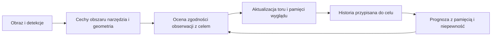

# Tożsamość narzędzia i rola rozszerzonego równania Langevina

Data: 2026-09-22. Status: audyt kodu i istniejących wyników, uzasadnienie teoretyczne oraz propozycja badania. Nie uruchomiono nowych treningów ani nowego testu reidentyfikacji. Poniższe wartości empiryczne pochodzą z zapisanych raportów. Proponowany model śledzenia nie jest jeszcze zaimplementowany.

Najważniejszy wniosek: istnieje uzasadnienie dla użycia równania z pamięcią do opisu częściowo obserwowanego stanu narzędzia. Trzeba jednak najpierw wykazać, że wybrana reprezentacja rozróżnia interesujące obiekty i zachowuje ich geometrię. Równanie nie nadaje współrzędnym znaczenia „tożsamość”. Etap 1 selekcji nie sprawdzał pełnego modelu grantowego ani zachowania tożsamości podczas śledzenia.

## 1. Co dokładnie zostało sprawdzone

Etap 1 miał wspólne 500 klatek i dobierał kolejne 1000, czyli każdy końcowy trening korzystał z 1500. Było dziewięć ramion i trzy ziarna treningu, przy jednym ziarnie doboru.

K1 korzystał z globalnych cech DINOv2: znormalizowany CLS połączony ze znormalizowanym maksimum po tokenach przestrzennych. To nie była reprezentacja trwale przypisanego narzędzia. Cechy rzutowano losowo do 24 wymiarów; nie była to redukcja PCA. Model obejmował dryf zależny od stanu, różnic pierwszego i drugiego rzędu, losowe cechy nieliniowe oraz historię ośmiu kroków. Score K1 był błędem predykcji poza grupą dopasowania, rangowanym wewnątrz operacji i łączonym z pokryciem cech.

W K1 nie było osobnego grantowego wymuszenia W, korektora dawnych reszt N ani członu zdarzeń Z. Wspólny schemat ideowy nie oznacza identyczności modeli.

Źródła: [model wizyjny](/F:/Studia/PhD_projekt/VIT/ViTParticleFilterTracker/SmallViTAblation/pipeline/koopman_langevin/latent_langevin.py:44), [macierz selekcji](/F:/Studia/PhD_projekt/VIT/ViTParticleFilterTracker/SmallViTAblation/pipeline/koopman_langevin/selection_matrix.py:128).

Wniosek „ten dobór klatek nie poprawił detektora” jest wsparty wynikami. Mocniejsze zdania z dokumentu 39 — że błędy są nieusuwalne etykietami i że poprawienie równania nie może pomóc — wykraczają poza eksperyment. Nie rozstrzygnięto wpływu innej reprezentacji, innych danych, modelu czasowego, rozdzielczości ani poprawy etykiet. Również podobny wynik placebo nie identyfikuje jednoznacznie przyczyny niewielkich różnic AP.

## 2. Cząstka, cecha i tożsamość to różne obiekty

W Grant cząstką jest jedna para sklep–produkt. Jej położenie to cały wektor 192 cech TFT, wyznaczony z okna 56 dni. W analizie checkpointów detektora cząstką nazwano jedną klatkę, obserwowaną przy kolejnych wagach. Na osi wideo kolejne wektory klatek tworzą trajektorię obserwacji. Żaden z tych sposobów nazewnictwa nie gwarantuje trwałego przypisania do konkretnego narzędzia.

Token ViT jest opisem fragmentu obrazu. Gdy narzędzie się przesuwa, ten sam indeks przestrzenny może już opisywać tło. Numer query DETR także nie jest identyfikatorem fizycznego obiektu. Cząstka filtra cząsteczkowego oznacza jeszcze coś innego: jedną hipotezę o ukrytym stanie i ewentualnie przypisaniu obiektu.

W badaniu należy rozdzielić:

| Własność | Pytanie | Czy obecne dane wystarczają? |
|---|---|---|
| Obecność i lokalizacja | Gdzie jest cystotom, gdzie jego końcówka? | Tak, w granicach jakości anotacji i dostępnych negatywów. |
| Typ | Czy to cystotom, pęseta czy inne narzędzie? | Obecna pula selekcji ma tylko cystotom. |
| Ciągłość celu | Czy detekcja należy do śledzonego celu sprzed kilku klatek? | Można badać utrzymanie celu w klipie; trudne powroty wymagają jawnej weryfikacji przypisania. |
| Egzemplarz | Czy wrócił ten sam fizyczny egzemplarz spośród dwóch podobnych? | Brakuje identyfikatorów egzemplarzy i odpowiednich przykładów. |

Paczka diagnostyczna ma 16 klipów, 4800 klatek, 12 klipów walidacyjnych i 4 treningowe. `tracks.json` zawiera split, grupę, odstęp, numer klatki, ramkę i końcówkę, bez ID egzemplarza. Zapisane latenty mają `query`, `box_pool`, `global_pool` po 256 cech, ramkę i score. Nie zawierają wszystkich queries ani pełnej mapy tokenów detektora.

## 3. Co już wiadomo o miejscu informacji w obrazie

W istniejącym pilocie odczyt liniowy położenia na innych grupach operacji dawał:

| Reprezentacja | R² położenia po treningu na 500 klatkach | R² po treningu na 2500 |
|---|---:|---:|
| `box_pool`: cechy wewnątrz przewidzianej ramki | 0,861 | 0,834 |
| `query`: zapytanie z najwyższym score | 0,679 | 0,692 |
| `global_pool`: średnia po całej mapie | 0,022 | −0,120 |

To jest wskazanie, gdzie szukać reprezentacji stanu narzędzia. Nie jest dowodem reidentyfikacji ani dowodem, że wskazano konkretne neurony tożsamości. `box_pool` jest wyznaczany przez przewidzianą ramkę, zatem część informacji o geometrii może wynikać z samego sposobu wyboru obszaru. Należy porównać go z samą geometrią ramki, ROI-GT i kontrolnymi obszarami tła. Cała ramka obejmuje też tkankę, więc maska narzędzia daje mocniejszą kontrolę niż box.

Źródło liczb: [REPORT_budget_axis.json](/F:/Studia/PhD_projekt/VIT/ViTParticleFilterTracker/SmallViTAblation/results/koopman_langevin_epochs/REPORT_budget_axis.json). Są to wyniki eksploracyjne. PCA w tym pilocie oraz część skalowania modeli dynamiki liczono przed rozdzieleniem foldów; dokumenty 37 i 38 opisują konieczne poprawki. Nie przedstawiamy tych liczb jako nowego, niezależnego potwierdzenia.

W K4 średnio 72,2% wariancji analizowanych współrzędnych przypadało na różnice między filmami. Geometria narzędzia słabo liniowo wyjaśniała te współrzędne. To wspiera interpretację silnego kodowania kontekstu filmu. Oko, oświetlenie i mikroskop są możliwymi przyczynami, nie osobno zmierzonymi czynnikami.

Dwie korekty techniczne wobec opisu historycznego: raport zawiera 10 rzeczywistych współrzędnych po rozłożeniu ośmiu wybranych funkcji własnych na części rzeczywiste i urojone oraz usunięciu kolumn stałych. Nazwy `pca16` i `random16` są mylące: kontrolne tablice także mają tu 10 współrzędnych. Ponadto `r2_from_tool_state` mierzy kierunek **geometria → współrzędne**, a nie odczyt geometrii ze współrzędnych. Wynik około −0,01 nie dowodzi braku wszelkiej, zwłaszcza nieliniowej, informacji o narzędziu.

Źródła: [raport K4](/F:/Studia/PhD_projekt/VIT/ViTParticleFilterTracker/SmallViTAblation/results/koopman_langevin_epochs/REPORT_koopman_cover.json:1), [definicja pomiaru](/F:/Studia/PhD_projekt/VIT/ViTParticleFilterTracker/SmallViTAblation/pipeline/koopman_langevin/koopman_cover_analysis.py:58).

## 4. Jakie jest rzeczywiste równanie z Grant

W wersji zdarzeniowej:

\[
\widehat z_{t+1|t}=z_t+D_t+JP_t+W_t+Z_t+N_t,
\qquad e_{t+1}=z_{t+1}-\widehat z_{t+1|t}.
\]

| Człon | Co rzeczywiście robi w kodzie | Możliwa funkcja w wideo, wymagająca sprawdzenia |
|---|---|---|
| D | Uczona funkcja stanu, prędkości i przyspieszenia latentu. | Krótka prognoza przesunięcia i zmiany wyglądu. |
| JP | Ważona historia stanów i prędkości, tłumione i oscylujące wagi z uwagą. | Odtwarzanie ukrytego kierunku ruchu i dłuższych zależności. |
| W | Reakcja na wejścia zewnętrzne i ich filtrowaną historię. | Uwzględnienie dostępnego ruchu kamery, jakości obrazu, ewentualnego sterowania robotem. |
| Z | Warunkowo reakcja na znane zniknięcie/powrót; prognostycznie oczekiwany powrót podczas trwającego braku. | Model zmiany widoczności, utraty detekcji lub rzeczywistego wejścia/wyjścia. |
| N | Deterministyczna korekta z dawnych reszt bazowych, z jądrami tłumionych cosinusów. | Wykorzystanie utrzymującego się wzorca błędów predykcji. |
| e | Pozostała reszta po wszystkich członach. | Materiał do modelowania niepewności; nie jest jeszcze gotowym rozkładem przejścia. |

Bazowe JP i N korzystają z horyzontu do 56 dni. Wariant Z dodaje kotwicę ostatniej obecności oraz odczepy reszt sprzed dnia i tygodnia. W `optymalizacja_95` badano także skalę ruchu osobną dla cząstki i reprezentację względem własnej średniej. Okres tygodnia i długości 56 nie mają automatycznego odpowiednika w filmie; okna należy ustalać w sekundach na danych treningowych.

N nie losuje szumu i nie estymuje jego kowariancji. W kodzie nie ma jawnego fizycznego tarcia, temperatury, masy ani potencjału. Sam podział sumy na D/JP/W/Z/N nie identyfikuje przyczyn fizycznych: człony mogą wyjaśniać nakładające się zależności, mimo osobnych parametrów i kary za podobieństwo wyjść.

Opis naukowy: **uczony dyskretny model dynamiki reprezentacji z pamięcią, wymuszeniem, zdarzeniami i korektą reszt, inspirowany uogólnionym równaniem Langevina**.

Źródła: [równanie bazowe i protokół](/F:/Studia/MCHTR/Grant/Projekt/experiments/tft_langevin_krok_po_kroku/README.md:10), [zdarzenia](/F:/Studia/MCHTR/Grant/Projekt/experiments/tft_langevin_czlon_zdarzen/model_z.py:98), [skalowanie](/F:/Studia/MCHTR/Grant/Projekt/experiments/tft_langevin_optymalizacja_95/model_s.py:58).

W Grant tryb warunkowy zna wejścia następnego dnia i odtwarza reakcję TFT. Tryb prognostyczny korzysta tylko z informacji dostępnej przy wydaniu prognozy. Nie wolno przenosić jakości pierwszego na deklarację przewidywania przyszłego obrazu. Dotychczasowe oceny krokowe aktualizowały historię rzeczywistą obserwacją po każdym kroku; nie dowodzą stabilności swobodnego przewidywania podczas długiego zasłonięcia.

## 5. Dlaczego pamięć ma podstawę teoretyczną

Obraz nie ujawnia całego stanu. Dwa identyczne położenia narzędzia mogą wystąpić przy ruchu w przeciwnych kierunkach. Pojedynczy embedding może także pomijać głębokość, kontakt z tkanką i ruch ręki. Historia może częściowo rozróżnić te przypadki.

Formalizm Mori–Zwanziga opisuje skutki redukcji pełnej dynamiki do wybranych obserwabli: pominięte zmienne mogą pozostawić pamięć i składnik nierozwiązany. To uzasadnienie struktury modelu, nie dowód, że dowolny latent i skończone jądro z kodu są dokładnym równaniem fizycznym. [Lin, Tian, Anghel i Livescu, 2021](https://arxiv.org/abs/2101.05873).

Prosty własny przykład algebraiczny pokazuje mechanizm bez odwoływania się do fizyki molekularnej. Załóżmy liniowy układ z obserwowanym z i ukrytym h:

\[
z_{t+1}=Az_t+Bh_t,\qquad h_{t+1}=Cz_t+Dh_t.
\]

Po podstawieniu kolejnych h otrzymujemy dokładnie:

\[
z_{t+1}=Az_t+\sum_{j=0}^{t-1}BD^jCz_{t-1-j}+BD^th_0.
\]

Pełny stan był Markowowski. Skrócony opis z ma pamięć i zależność od nieznanego stanu początkowego. Przy dodatkowych nieobserwowanych wymuszeniach dochodzą ich przefiltrowane wpływy. Nie wynika stąd białość, gaussowskość ani termiczny charakter reszty.

Związek z autoregresją jest istotą uzasadnienia, a nie problemem do ukrycia. Lin i Lu pokazują pomost między redukcją Mori–Zwanziga, NARMAX i filtrowaniem Wienera. Dlatego model trzeba porównać z równie dobrze dopasowanym AR/VAR/NARX o takim samym dostępie do historii. [Lin i Lu, 2021](https://doi.org/10.1016/j.jcp.2020.109864).

Można także precyzyjnie określić potencjalny zysk z historii. Dla celu Y, historii H zawierającej z_t i skończonego drugiego momentu:

\[
\mathbb E\|Y-\mathbb E[Y\mid z_t]\|^2-
\mathbb E\|Y-\mathbb E[Y\mid H]\|^2
=\mathbb E\|\mathbb E[Y\mid H]-\mathbb E[Y\mid z_t]\|^2\geq0.
\]

Tożsamość wynika z ortogonalności błędu warunkowej wartości oczekiwanej. Mówi o optymalnych predyktorach i wartości informacji. Skończony, wyuczony model może pogorszyć wynik przez błąd estymacji lub niedopasowanie. Y powinno być stanem albo wynikiem zadania interesującego użytkownika; przewidywanie średniej jasności nie jest sukcesem śledzenia.

## 6. Co konkretnie może dać w obrazie i śledzeniu

Docelowo oddzielić opis wyglądu/tożsamości a, geometrię g, ruch v i stan widoczności o. To propozycja konstrukcji, nie odkryty już rozkład obecnego latentu. Wygląd powinien zachowywać zgodność tego samego celu przy zmianie oświetlenia. Geometria powinna poprawnie zmieniać się przy translacji i obrocie. Wymuszanie niezmienności całego wektora usunęłoby informację potrzebną do lokalizacji.

Przykłady spodziewanej funkcji:

- **Odblask obok narzędzia.** Detektor może nadać mu wysoki score. Zgodność położenia, kierunku ruchu i wyglądu z historią stanowi dodatkową przesłankę przy przypisaniu detekcji. Sam score dynamiki nie rozstrzyga, czy zaszedł prawdziwy nagły ruch.
- **Krótka utrata widoczności.** Tracker propaguje hipotezy i zwiększa niepewność. Nie aktualizuje wzorca wyglądu przypadkowym fragmentem tkanki. Przy dłuższej przerwie utrzymuje więcej możliwych stanów albo jawnie kończy pewne przypisanie.
- **Powrót po zasłonięciu.** Wygląd i zgodność czasowo-przestrzenna wspólnie pomagają wybrać kontynuację. Nie wolno automatycznie przyciągać ramki do miejsca sprzed zasłonięcia: obiekt mógł się przesunąć.
- **Nagła zmiana kierunku.** Dodatkowy model zdarzeń może zwiększyć dopuszczalny zakres ruchu, zamiast wymuszać gładką kontynuację. Sama duża reszta jest jednak alarmem, nie etykietą przyczyny.

Połączenie predykcji w latentach z filtrowaniem ma precedens w Recurrent Kalman Networks. Łączenie ruchu i pamięci wyglądu w asocjacji ma precedens w Deep SORT. Te prace wspierają konstrukcję badania, ale nie dowodzą zysku naszego równania w chirurgii. [Becker i in., 2019](https://proceedings.mlr.press/v97/becker19a.html), [Wojke i in., 2017](https://arxiv.org/abs/1703.07402).

Do filtra cząsteczkowego trzeba dodatkowo zbudować rozkład przejścia i model wiarygodności obserwacji. Sama punktowa prognoza z Grant nie wystarczy. Każda cząstka filtra może wtedy reprezentować hipotezę o położeniu, ruchu, widoczności i przypisaniu. Model dynamiki propaguje hipotezy, obraz aktualizuje ich wagi. Niepewność modelu i szum pomiaru wymagają oddzielnej kalibracji. [Arulampalam i in., 2002](https://doi.org/10.1109/78.978374).

Pamięć JP i stan korektora N muszą także wejść do rozszerzonego stanu filtra albo pozostać jawną historią każdej hipotezy. Podczas braku obserwacji nie znamy nowych rzeczywistych reszt. Nie wolno zasilać N błędem względem nieistniejącego pomiaru ani przyszłą klatką; potrzebna jest jawna reguła propagowania lub wygaszania stanu korektora. Dlatego ocena rolloutów przez zasłonięcie jest odrębnym testem od prognozy jednego kroku z pełną obserwowaną historią.

Najważniejsza analogia zdarzeń jest ograniczona: brak wiersza sprzedaży zmienia obserwację TFT, a zasłonięcie zmienia obserwację narzędzia. Żadne z nich nie oznacza automatycznie skoku stanu fizycznego. W Grant prognostyczny Z obniżył wynik do 40,7 wobec 44,2 po jego wyłączeniu, ponieważ model cofał latent również podczas trwającej przerwy. Nie należy kopiować tego mechanizmu jako pewnego powrotu geometrycznego. [Wyniki Z](/F:/Studia/MCHTR/Grant/Projekt/experiments/tft_langevin_czlon_zdarzen/WYNIKI.md:58).

## 7. Jak ustalić, które cechy opisują narzędzie

Nie zakładać, że pojedynczy kanał odpowiada jednemu znaczeniu. Równoważne obroty przestrzeni cech mogą zmieniać numery osi bez zmiany informacji. Szukać funkcji lub podprzestrzeni stabilnie zachowującej własność zadaniową. Brak ogólnej identyfikowalności nienadzorowanego rozdzielenia czynników uzasadnia użycie etykiet, kontrolowanych zmian i jawnych założeń; nie oznacza niemożliwości uczenia z nadzorem lub czasem. [Locatello i in., 2019](https://proceedings.mlr.press/v97/locatello19a.html).

Proponowany pierwszy etap, bez ponownej kampanii treningów detektora:

1. **Przypisanie obiektu.** Zamrozić detektor i zbiór operacji. Tworzyć odcinki tego samego celu; użyć istniejących anotacji do kontroli i oznaczyć niejednoznaczne powroty. Nie traktować indeksu query jako ID.
2. **Porównanie reprezentacji.** Te same klatki: sama geometria, globalne cechy, cechy ROI-GT, ROI-detektora i osobna kontrola tła. Dla maski wykorzystać segmentację cystotomu z surowych anotacji, po sprawdzeniu jej zgodności z klatkami.
3. **Odczyt informacji.** Badać geometrię i widoczność na innych operacjach. Rozpoznawanie typu dodać dopiero z wieloma klasami. Test rozróżniania egzemplarzy wymaga nowych ID; „ten sam film” nie może zastąpić etykiety „to samo narzędzie”.
4. **Kontrole tła i geometrii.** Zmieniać jasność/tło przy zachowaniu narzędzia; przy translacji/obrocie sprawdzać przewidywalną zmianę geometrii, przy zachowaniu zgodności wyglądu. Wersje obrazów nie mogą przechodzić między train i test. Oddzielić efekt sztucznych krawędzi masek od badanego efektu.
5. **Wpływ tokenów i podprzestrzeni.** Usuwać wskazane tokeny, maskować porównywalny obszar tła i zakłócać kontrolne podprzestrzenie tego samego wymiaru. Wymagać spadku zdolności przypisania celu po usunięciu cech narzędzia. Wysoka uwaga lub sonda liniowa sama nie wystarcza. Każda ingerencja może wyprowadzić dane poza rozkład, więc potrzebuje kontroli losowej i porównywalnej siły zakłócenia.

Sondę identyfikatora filmu można dopasować na czasowo oddzielonych blokach tych samych filmów jako diagnostykę kontekstu. Jej wynik nie jest miarą generalizacji do nowej operacji i nie zastępuje klasyfikacji tożsamości. Z kolei odczyt położenia/typu i dobór podprzestrzeni muszą być oceniane na innych grupach operacji, z całym preprocessingiem dopasowanym wyłącznie na train.

Rozdzielenie obiektów, ich atrybutów i dynamiki jest także punktem wyjścia prac Koopmanowskich nad wideo. Stanowi właściwszy precedens niż dynamika globalnej cechy całej sceny. [Comas i in., 2023](https://proceedings.mlr.press/v211/comas23a.html).

## 8. Jak sprawdzić wartość pełnego równania

Po ustaleniu reprezentacji, na tych samych detekcjach i torach porównać: brak ruchu, stałą prędkość/odporny Kalman, elastyczny model bieżącego stanu, AR/VAR lub NARX z tą samą historią, D+JP, D+JP+N oraz wariant ze zdarzeniami. W dodawaniu W uwzględniać wyłącznie informacje rzeczywiście dostępne w chwili decyzji. Różnice pierwszego i drugiego rzędu już korzystają z historii; model D(z,v,a) nie jest kontrolą bez historii.

Oceny muszą odpowiadać zastosowaniu:

| Cel | Pomiar |
|---|---|
| Przewidywanie geometrii | Błąd końcówki, środka, orientacji, IoU; osobno horyzonty i pełny rollout przez brak obserwacji. |
| Niepewność | Pokrycie przedziałów/obszarów i ich szerokość, właściwy score probabilistyczny. |
| Utrzymanie celu | Czas utraty celu, powroty po zasłonięciu, fałszywe przejęcia refleksu lub innego narzędzia. |
| Wieloobiektowa tożsamość | ID switches, IDF1/AssA, fragmentacje, po uzyskaniu wiarygodnych ID. |
| Przydatność operacyjna | Opóźnienie, koszt obliczeń i częstość nieuzasadnionych alarmów. |

Raportować wyniki po operacjach i zdarzeniach, nie traktować sąsiednich klatek jako niezależnych powtórzeń. Zamrozić recepturę przed końcową oceną. Dotychczas oglądane val/test pozostają materiałem eksploracyjnym; ich status nie resetuje się przez zmianę nazwy eksperymentu.

Istnieje konkretny próg odniesienia: pilot odpornego filtra na ramkach detektora b2500 dał R² prędkości 0,438, a filtr z położenia odczytanego z `box_pool` 0,044. Cel prędkości w tym pilocie korzysta z lokalnie wygładzonego toru GT, a wariant różnicowy ma dostęp do obustronnego okna, więc nie są to identyczne protokoły online. Niemniej latent nie wykazał przewagi nad samą ramką. Nowy model powinien poprawić śledzenie ponad tę prostszą informację, a nie wyłącznie lepiej odtwarzać własne cechy. [REPORT_kalman_ut_b2500_best.json](/F:/Studia/PhD_projekt/VIT/ViTParticleFilterTracker/SmallViTAblation/results/koopman_langevin_epochs/REPORT_kalman_ut_b2500_best.json).

## 9. Teza, którą można obecnie obronić

Rozszerzone równanie Langevina może pełnić rolę parametrycznego modelu przejścia dla częściowo obserwowanej reprezentacji narzędzia. Pamięć wykorzystuje informację pominiętą przez pojedynczy obraz, korektor reszt opisuje pozostałe przewidywalne zależności, a model zdarzeń rozdziela zmiany widoczności od zwykłego ruchu. Po uzupełnieniu o model obserwacji i skalibrowany rozkład niepewności konstrukcja może wspierać asocjację i podtrzymanie toru. To hipoteza zastosowania. Nie ma jeszcze pomiaru wykazującego, że pełna konstrukcja poprawia tożsamość lub tracking narzędzia.

Najbliższy rozstrzygający wynik powinien brzmieć: na niezależnych operacjach i tych samych detekcjach reprezentacja obiektu plus model z pamięcią zmniejsza utraty celu lub błędne przypisania względem wyglądu i prostego filtra. Samo AP selekcji klatek ani procent przewidzianego ruchu latentu nie rozstrzygają tego pytania.
