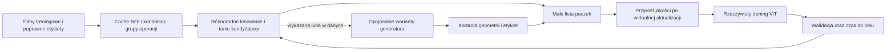

# Jak przyspieszyć uczenie detektora ViT: synteza eksperymentów i plan zmian

Data i cutoff: 2026-10-04. Przedmiot: wybór danych do detekcji narzędzia chirurgicznego, dynamika reprezentacji, FastGAN/SD oraz interwencje J128. To audyt i projekt następnych porównań. Nie uruchamiano nowych treningów, generowania obrazów ani jobów Edena.

## 1. Wniosek i rekomendacja

**Rekomenduję pętlę: różnorodne prawdziwe klatki → tani wybór kandydatów → ocena rzeczywistej korzyści treningowej na małej liczbie paczek → aktualizacja ViT → kontrola czasu do zadanej jakości.** Generator i długi model dynamiki powinny wejść do niej dopiero wtedy, gdy osobno wykażą dodatkową korzyść po doliczeniu kosztu.

Dotychczasowe badania dają dodatni sygnał dla doboru klatek w małym ViT uczonym od zera. Nie dowodzą jeszcze przyspieszenia całego procesu w sekundach. W dostrajaniu RF-DETR korzyść jest znacznie słabsza i czasem wygrywa losowanie albo brak dokładania danych. Dlatego rozdzielam dwa cele: praktycznie szybki detektor z pretrainingu oraz badanie uczenia reprezentacji od zera. Ich AP, koszty i możliwości selekcji nie są zamienne.

Trzy priorytety:

1. **Oszczędzić zbędne uczenie i pomiary.** Wprowadzić sprawdzony prospektywnie warunek zatrzymania, ciągłość optymalizatora, tani monitoring i poprawne zegary. To najbardziej bezpośredni trop z istniejącej telemetrii.
2. **Sprawdzić wyszukiwanie prawdziwych klatek bez generatora.** To brakująca kontrola, która może zachować część korzyści obecnej metody przy niższym koszcie.
3. **Zamienić cel „duża siła tożsamości” na „poprawa detektora po treningu na paczce”.** J128 i Langevin mogą być pomocniczą reprezentacją oraz przybliżeniem skutku kroku, ale nie są samodzielną funkcją jakości treningu.

## 2. Zakres dowodów i granice przeglądu

Zinwentaryzowano **59 katalogów rodzin eksperymentów**: 56 w SmallViTAblation i 3 nowe eksperymenty Grant. Zachowano migawkę **223 dokumentów Markdown**, w tym dokumentacji nadrzędnej. Katalog rodziny nie jest pojedynczym treningiem: część zawiera kampanie po 10–20 ziaren, część tylko plan lub ekstrakcję danych. Przejrzano raporty, podsumowania i dopiski wyników w planach; dla wniosków decydujących o pipeline dodatkowo kod, metryki i logi.

Przeanalizowano **840 rekordów OBROT.json**, 60 końcowych zapisów kampanii 4.3 oraz jej zagregowane metryki. To ponowne obliczenia na zapisanych wynikach, bez nowego inference. Kod bieżący zamrożono osobno; nie utożsamiam jego całości z wersją historycznego joba. Błąd zegara jest potwierdzony także w historycznych JSON-ach i logu. Sposób wyboru kotwic potwierdzają zapisane siły i bieżący kod; brak pełnego archiwum wykonanego źródła pozostaje ograniczeniem pochodzenia.

Materiały: [inwentarz i ocena wszystkich rodzin](materialy/vit-pipeline-2026-10-04/POKRYCIE.md), [CSV](materialy/vit-pipeline-2026-10-04/INWENTARZ.csv), [manifest dokumentów z SHA256](materialy/vit-pipeline-2026-10-04/MANIFEST.json), [telemetria i obliczenia czasu](materialy/vit-pipeline-2026-10-04/TELEMETRIA_43.json), [manifest kodu](materialy/vit-pipeline-2026-10-04/MANIFEST_KOD.json).

Undermind zakończył nowy deep search: **179 prac**. Odczyt pełnych tekstów przez usługę objął osiem wybranych prac, a dodatkowo sprawdzono źródła pierwotne w internecie. Nie przeczytano wszystkich 179 prac w całości. [Wyszukiwanie](https://app.undermind.ai/projects/40294fa6-c9a3-4469-9a61-d3eddeaee893?path=/Accelerating%20detector%20training%20through%20useful%20data%20selection%20and%20reachable%20latent%20targets), [odczyty 1](materialy/vit-pipeline-2026-10-04/papers_read1.md), [odczyty 2](materialy/vit-pipeline-2026-10-04/papers_read2.md).

Nie zweryfikowano każdej historycznej wagi i każdego surowego tensoru. Brak końcowego raportu w katalogu oznacza brak dowodu w sprawdzonym materiale, a nie dowód niewykonania obliczeń. Nie włączam niepowiązanych treningów TFT do rankingu metod ViT. Również serwowizja i głębia igły rozwiązują inne zadania.

## 3. Co mówią wyniki, gdy rozdzielimy zadania i metryki

| Eksperyment | Dowód liczbowy | Co z niego wynika dla przyspieszenia |
|---|---|---|
| Krystalizacja / telemetria RF-DETR | 28 biegów: mediana szczytu w epoce 8, zakres 4–16; raport wskazuje bliskość szczytu już około epoki 6. Przy 30 epokach spadek jakości około 0,03. Trzy dodatkowe biegi: minimum val loss w epokach 6/6/7 | Silny powód do zbadania krótszej receptury i wcześniejszego zatrzymywania. Wybranie idealnej epoki po fakcie nie jest jeszcze wykonalną regułą stopu |
| Dobór cech adaptacyjny, 3 ziarna | Najlepsza walidacyjna AP50:95: losowe 0,7131; przybliżony GLISTER 0,7072; cechy+GLISTER 0,6903; cechy+Koopman/GLE 0,6839 | Złożoność selektora nie zapewniła przewagi. Należy zachować eksplorację i pokrycie danych |
| Dobór klatek wg stanu, pilot 1 ziarna | AP50:95 końcowe: K+GLE 0,67317 vs random1500 0,65547 i random3000 0,67122 | Dodatni pilot jakości, słaby dowód generalności i brak wygranej czasu całego procesu |
| Nano + Koopman/FastGAN, 1 ziarno | Średnia AP50 po ocenach: metoda 0,8981, random 0,8973, bez dodawania 0,8989 | Na już dobrym detektorze dokładanie nie pomogło w tym pilocie |
| Large + pętla, 3 ziarna | Średni kontrast pola metoda−random około −0,0030; jedna historyczna końcówka kampanii niekompletna | Nie ma przewagi tej receptury. Zmiany LR, optimizer reset i liczby prezentacji bazy trzeba oddzielić od selekcji |
| Mały ViT od zera, 11 ziaren | Średnia AP50 po ocenach 0,4426 vs random 0,4298, 9/11 wygranych | Dobór danych może pomagać; nietrafna prognoza i nietrafiona inwersja nie wyjaśniają mechanizmu |
| Pętla siły tożsamości, 20 ziaren | Pole 0,478 vs random 0,468; 15/20 wygranych. Końcowe 0,545 vs 0,536. Ramię current na końcu 0,548 | Sygnał wcześniejszej poprawy, bez spełnienia z góry ustawionego progu 16/20. Historycznie metoda dodała mniej klatek niż random |
| SD 4.3, 10 ziaren, wyrównany budżet | Pole: metoda 0,4883, current-SD 0,4871, random 0,4720. Metoda>random 10/10; końcowy kontrast +0,022, p=0,13 | Najmocniejszy dodatni wynik dla jakości przy tej samej liczbie aktualizacji. Nie rozstrzyga czasu do celu ani osobnego wkładu SD |
| Osobne macierze RF-DETR, 41 472 trajektorie | H100: RMSE Koopman 0,2322; persistence 0,1362; tłumiony ostatni przyrost 0,0711 | Prosty model pamięci jest obowiązkowym konkurentem; 41 tys. tokenów nie stanowi 41 tys. niezależnych treningów |
| Koopman z pamięcią RF-DETR | Wybór na kalibracji: H100 RMSE 0,0762, lepiej od persistence 0,1362; H5 poprawa wobec ostatniego przyrostu 3,9% | Rzeczywisty dodatni wynik prognozy w określonej trajektorii. Nie jest dowodem wyboru lepszych danych ani przewagi nad tłumieniem w każdym horyzoncie |
| Pełne cząsteczki SmallViT, pilot | PCA8+AR(1): H100 RMS 0,9569×persistence; pełny ridge 768D 1,1433× | Jest mały dodatni wynik predykcyjny, także po ocenie w pełnych 768D. Nie uzasadnia eskalacji do dużego modelu bez testu użyteczności |
| NNDMD lokalnych przyrostów na Hopper | RMSE 768D 0,159935 vs persistence 0,139319; 128D 0,141612 vs 0,122625 | Większy trening nie naprawił prognozy. Nie rekomenduję obecnie większej kampanii tej samej konstrukcji |
| Interwencja oracle J128, 400 obrazów | AP50 0,437555 → 0,884748; AP50:95 0,120881 → 0,770525 | Istnieją skuteczne interwencje wewnętrzne zależne od obrazu i jego etykiety. To nie wynik wyuczonego detektora na nowych danych |
| Jeden obraz SD z tego celu | Błąd dopasowania J128 spadł zaledwie o 0,0612%; confidence 0,8323 → 0,8546 | Przepływ generowania działa, ale ten obraz praktycznie nie odtworzył celu. Nie ma przeniesienia wyniku AP50=0,885 |

Źródła do tabeli: [telemetria RF-DETR](materialy/vit-pipeline-2026-10-04/snapshot/smallvit/krystalizacja_latentu/README.md), [selekcja adaptacyjna](materialy/vit-pipeline-2026-10-04/snapshot/smallvit/dobor_cech_adaptacyjny/WYNIKI_KAMPANII_2026-09-22.md), [pilot stanu sieci](materialy/vit-pipeline-2026-10-04/snapshot/smallvit/dobor_klatek_stan_sieci/WYNIKI_PILOT.md), [Nano](materialy/vit-pipeline-2026-10-04/snapshot/smallvit/petla_uczenia_koopman_fastgan/WYNIKI.md), [Large](materialy/vit-pipeline-2026-10-04/snapshot/smallvit/petla_od_poczatku_large/WYNIKI.md), [SmallViT od zera](materialy/vit-pipeline-2026-10-04/snapshot/smallvit/maly_vit_od_zera/PLAN.md), [20 ziaren](materialy/vit-pipeline-2026-10-04/snapshot/smallvit/maly_vit_petla_sila_tozsamosci/PLAN.md), [SD 4.3](materialy/vit-pipeline-2026-10-04/snapshot/smallvit/maly_vit_petla_sd_rownanie/WYNIKI.md), [macierze RF-DETR](materialy/vit-pipeline-2026-10-04/snapshot/smallvit/koopman_osobno_obraz_token/WYNIKI_TEST.md), [pamięć](materialy/vit-pipeline-2026-10-04/snapshot/smallvit/koopman_z_pamiecia/WYNIKI.md), [PCA pilot](materialy/vit-pipeline-2026-10-04/snapshot/smallvit/maly_vit_dynamika_pelnych_czasteczek_checkpointy/WYNIKI_PILOT.md), [NNDMD](materialy/vit-pipeline-2026-10-04/snapshot/smallvit/maly_vit_nndmd_lokalne_przyrosty_hopper/WYNIKI.md), [oracle](materialy/vit-pipeline-2026-10-04/snapshot/grant/vit_latent128_maksymalizacja/WYNIKI.md), [obraz SD](materialy/vit-pipeline-2026-10-04/snapshot/grant/vit_latent128_obraz_sd/WYNIKI_SD.md).

**Nie łączyć wartości z różnych wierszy w jedną „trafność”.** AP50, AP50:95, AUROC sondy, confidence pojedynczej ramki i redukcja MSE prognozy mierzą inne rzeczy. „Pole” kampanii 4.3 to `mean(mAP)` po regularnych punktach aktualizacji, a nie całka po rzeczywistym czasie. Większość przewag to wyniki walidacyjne wielokrotnie oglądanych benchmarków; obecny raport nie zmienia ich w nietknięty test.

## 4. Najważniejsze nowe ustalenia audytu

### A-01 - Błędna telemetria czasu i niepotwierdzone przyspieszenie całej pętli

**Rejestr:** [[AU59]]

**P1 · POTWIERDZONE · OTWARTE · pewność wysoka.**

W 420/840 rekordów rund pola sekund mają wartości około 1,79 miliarda. Dotyczy to wszystkich 140 rund każdego z trzech ramion SD. Zmienna `tk` najpierw przechowuje czas startu, potem liczbę sąsiadów top-k, a na końcu jest odejmowana od `time.time()`. Historyczny log drukuje te same nierealne czasy. `KONIEC.sekundy` jest natomiast czasem narastającym od początku procesu, a nie czasem danego ramienia. Analiza AP liczy średnią ocen po krokach, nie jakość w funkcji sekund.

**Wpływ:** To nie unieważnia zapisanych wartości AP. Unieważnia interpretację surowych OBROT.sekundy jako czasu trwania i nie uzasadnia twierdzenia o przyspieszeniu całej pętli. Z różnic narastających końców następujących po sobie ramion odtworzono przybliżony czas kompletnego ramienia current-SD: mediana 629,04 s, random 302,97 s, mediana sparowanego ilorazu 2,080. Obejmuje to narzut pomiędzy ramionami i 14 rund; wyklucza wcześniejsze wspólne przygotowanie, trening generatora i nie daje czasu do tej samej jakości. Kolejność ramion nie była randomizowana. Sam iloraz nie dowodzi, że random zawsze wcześniej osiąga dany AP.

**Dowody:** [TELEMETRIA_43.json](materialy/vit-pipeline-2026-10-04/TELEMETRIA_43.json); [petla4.py](materialy/vit-pipeline-2026-10-04/kod_i_metryki/experiments/maly_vit_petla_sd_rownanie/kod/petla4.py); [analiza43.py](materialy/vit-pipeline-2026-10-04/kod_i_metryki/experiments/maly_vit_petla_sd_rownanie/analiza43.py).

**Kryterium zamknięcia:** Osobne nazwy zegara i top-k, monotoniczny pomiar etapów, poprawne czasy nowej krótkiej replikacji oraz krzywa AP względem rzeczywistych sekund. Nie zastępować brakującego czasu przez liczbę aktualizacji. Test rozstrzygający: niewykonany w tym audycie.

### A-02 - Niepełna ablacja prognozy i brak kontroli wyszukiwania bez generatora

**Rejestr:** [[AU60]]

**P1 · POTWIERDZONE · OTWARTE · pewność wysoka.**

W gałęzi metoda/metoda_kl3/sd_bez_prognozy kotwice wybierane są według `abs(d[j])`. Dla sd_bez_prognozy `d` pochodzi z GLE; dopiero `dz` ustawiane jest na zero. Ramię nadal zależy więc od prognozy w doborze kotwic. Zachowane rekordy zawierają prognozowane zmiany GLE mimo zerowego przesunięcia docelowego. Dodatkowo nie ma ramienia z tymi samymi prawdziwymi kotwicami i retrieval bez SD.

**Wpływ:** Kontrast metoda−current-SD = +0,0012, p=1,0 nie wykazuje korzyści przesunięcia celu latentowego w tym ustawieniu. Nie dowodzi zerowego udziału całej prognozy. Przewaga kombinacji nad random nie izoluje korzyści generatora. Raportowy zwrot „zysk daje SD, nie prognoza” jest za mocny.

**Dowody:** [petla4.py](materialy/vit-pipeline-2026-10-04/kod_i_metryki/experiments/maly_vit_petla_sd_rownanie/kod/petla4.py); [WYNIKI.md](materialy/vit-pipeline-2026-10-04/snapshot/smallvit/maly_vit_petla_sd_rownanie/WYNIKI.md); [TELEMETRIA_43.json](materialy/vit-pipeline-2026-10-04/TELEMETRIA_43.json).

**Kryterium zamknięcia:** Pełna ablacja prognozy w wyborze kotwic i celu osobno, oraz kontrola prawdziwa kotwica→retrieval bez SD przy tych samych ograniczeniach, budżecie, stanie modelu i pomiarze czasu. Test rozstrzygający: niewykonany w tym audycie.

### A-03 - Oracle J128 nie przenosi się automatycznie na obraz ani trening

**Rejestr:** [[AU61]]

**P1 · POTWIERDZONE · OTWARTE · pewność wysoka.**

Wynik AP50=0,884748 uzyskano przez indywidualną optymalizację 600×128=76 800 liczb na obraz, razem 30,72 mln zmiennych, z etykietami każdego z 400 obrazów. Wagi zamrożono. Kontrola losowych znaków dziedziczy moduły zmian wyliczone z GT. Maksymalna zmiana współrzędnej wynosi 201,51. Jedna inwersja SD redukuje MSE celu tylko o 0,0612%. Funkcja tail używa residualu oryginalnego obrazu; generowanie nowego obrazu zmienia residual i gałąź MLP.

**Wpływ:** Oracle pokazuje możliwości interwencji, nie samodzielną poprawę detektora ani osiągalność celu przez zdjęcie. Dolna granica GELU jest koniecznym ograniczeniem wartości, ale nie pełnym opisem zbioru realnych reprezentacji. Nawet zgodność samego z nie gwarantuje zgodności końcowego h=residual+MLP(z). Wynik jednej nieudanej inwersji nie dowodzi niemożliwości inwersji.

**Dowody:** [WYNIKI.md](materialy/vit-pipeline-2026-10-04/snapshot/grant/vit_latent128_maksymalizacja/WYNIKI.md); [WYNIKI_SD.md](materialy/vit-pipeline-2026-10-04/snapshot/grant/vit_latent128_obraz_sd/WYNIKI_SD.md); [core.py](materialy/vit-pipeline-2026-10-04/kod_i_metryki/experiments/vit_optymalizacja_latentu128/core.py).

**Kryterium zamknięcia:** Wspólny adapter oceniony bez etykiet nowych obrazów albo udana inwersja osiągalnego stanu wraz z residualem/stanem po residualu; potem osobno sprawdzony wpływ wygenerowanych danych na trening. Niezależne kontrole kanałów i normy bez GT-oracle. Test rozstrzygający: niewykonany w tym audycie.

### A-04 - Siła tożsamości nie jest zweryfikowaną miarą użyteczności treningowej

**Rejestr:** [[AU62]]

**P1 · POTWIERDZONE · OTWARTE · pewność wysoka.**

Historyczne testy sond i mAP rozchodzą się: Large po kontrolowaniu fazy/ziarna daje słabą zależność (raport rho≈0,07), a wcześniejszy LDA odczytuje prostą różnicę metal/tło także z nieuczonej sieci. Przybliżony GLISTER opiera się na końcowych warstwach głowicy i wirtualnym SGD przy realnym AdamW; kampania trzech ziaren nie pokonała random. Nowsze J128 z oryginał/LaMa jest mocnym odczytem dla konkretnego kontrastu, a nie dowodem wyłącznej przyczynowej tożsamości.

**Wpływ:** Maksymalizacja rzutu, normy latentu lub confidence może wybrać dane łatwe, redundantne albo wykorzystujące artefakt, zamiast uczących. Nie ma uzasadnienia wyznaczania jednego uniwersalnego maksimum 128 współrzędnych jako końca uczenia. Brak przewagi GLISTER nie dowodzi, że wszystkie kryteria gradientowe są nieskuteczne.

**Dowody:** [DIAGNOZA_PORAZKI.md](materialy/vit-pipeline-2026-10-04/snapshot/smallvit/petla_od_poczatku_large/DIAGNOZA_PORAZKI.md); [PLAN.md](materialy/vit-pipeline-2026-10-04/snapshot/smallvit/sterowanie_langevin_kalman/PLAN.md); [PLAN.md](materialy/vit-pipeline-2026-10-04/snapshot/smallvit/maly_vit_wektor_tozsamosci/PLAN.md); [WYNIKI_KAMPANII_2026-09-22.md](materialy/vit-pipeline-2026-10-04/snapshot/smallvit/dobor_cech_adaptacyjny/WYNIKI_KAMPANII_2026-09-22.md); [rfdetr_backend.py](materialy/vit-pipeline-2026-10-04/kod_i_metryki/experiments/dobor_cech_adaptacyjny/rfdetr_backend.py).

**Kryterium zamknięcia:** Prospektywny ranking paczek wobec spadku straty detekcyjnej po dokładnym kroku optymalizatora, kontrola różnorodności i szumu etykiet, a następnie przewaga czasu do AP na odłożonych grupach. Test rozstrzygający: niewykonany w tym audycie.

### A-05 - Rekonstrukcja Langevina i diagnostyka szumu nie ustalają granicy prognozy

**Rejestr:** [[AU63]]

**P2 · POTWIERDZONE · OTWARTE · pewność wysoka.**

Wynik około 94% dla H100 używa sił liczonych na rzeczywistych przyszłych wagach. Jest rekonstrukcją warunkową, a nie autonomiczną prognozą stanu z chwili startu. Siła paczki wymaga gradientu i przejść przez sieć. Oddzielne dodatnie wyniki na H100 dotyczą często jednej skalarnej projekcji. Wygładzenie znanej przyszłej trajektorii i brak prostej autokorelacji nie są dowodem absolutnej granicy przewidywalności z pełnego stanu.

**Wpływ:** Nie wolno przenosić liczby 94% na pełne wektory bez przyszłych wejść ani traktować udziału wysokich częstotliwości jako udowodnionego nieusuwalnego szumu. Jednocześnie lokalne modele pamięci i PCA mają pewne dodatnie wyniki; należy je zachować jako punkty odniesienia, bez gwarancji sterowania treningiem.

**Dowody:** [WYNIKI.md](materialy/vit-pipeline-2026-10-04/snapshot/smallvit/maly_vit_horyzont_rownania_krok/WYNIKI.md); [WYNIKI.md](materialy/vit-pipeline-2026-10-04/snapshot/smallvit/maly_vit_sufit_przewidywalnosci_100/WYNIKI.md); [WYNIKI.md](materialy/vit-pipeline-2026-10-04/snapshot/smallvit/maly_vit_tozsamosc_jeden_krok/WYNIKI.md); [WYNIKI.md](materialy/vit-pipeline-2026-10-04/snapshot/smallvit/maly_vit_horyzont_prognozy/WYNIKI.md).

**Kryterium zamknięcia:** Raporty jawnie opisujące wejścia dostępne na początku, horyzont w aktualizacjach, rozmiar stanu, metrykę MSE/RMSE i kontrolę. Empiryczny test warunkowej prognozy oraz kalibracji niepewności, zamiast twierdzenia o fizycznej niemożliwości. Test rozstrzygający: niewykonany w tym audycie.

## 5. Właściwy cel matematyczny

Niech `x_p` będzie stałym obrazem sondującym, `B` kandydacką paczką danych, a `s_t` pełnym stanem uczenia: wagi, momenty AdamW, bufory, scheduler i licznik kroku. Oznaczmy rzeczywistą aktualizację przez `U`.

\[
s_{t+1}(B)=U(s_t,B),\qquad
\Delta z_B(x_p)=z_{s_{t+1}(B)}(x_p)-z_{s_t}(x_p).
\]

To jest skutek **uczenia na B** dla tego samego obrazu. Natomiast inwersja generatora szuka `x`, dla którego `z_{s_t}(x)` przypomina zadany wektor przy niezmienionych wagach. To inne odwzorowanie. Obraz, który już daje wysoką pewność poprawnej klasy, może nie dostarczać dużego użytecznego sygnału treningowego. Ten związek trzeba zmierzyć, a nie zakładać.

Paczki oceniałbym przez stratę detekcyjną na oddzielnym, oznaczonym zbiorze kontrolnym C z treningowej części danych:

\[
u_t(B)=L_C(s_t)-L_C(U(s_t,B)).
\]

`L_C` obejmuje natywny składnik obiektu/klasy, lokalizacji oraz fałszywe detekcje tła. Nie jest mAP-em i wymaga sprawdzenia zgodności rankingu z późniejszym AP. Dodatnie `u` oznacza, że po hipotetycznym treningu na B sieć lepiej rozwiązuje zadanie na C. C jest informacją uczącą selektor, więc nie wolno nazywać go końcowym testem.

Tańszy lokalny przybliżony score:

\[
u_t(B)\approx-\nabla_\theta L_C(\theta_t)^\top\Delta\theta_B.
\]

Dla zwykłego SGD daje to `η g_Cᵀg_B`. Dla AdamW należy wyznaczyć faktyczny krok z aktualnymi momentami, korektą obciążenia, nowym gradientem w drugim momencie, weight decay, learning rate i clippingiem. Sam iloczyn surowych gradientów głowicy nie odwzorowuje automatycznie tego kroku.

**Nie trzeba od razu różniczkować przez setki aktualizacji.** Najpierw porównać tani score z jednym rzeczywistym wirtualnym krokiem na kopii pełnego stanu; potem z kilkoma krokami. Ocena wszystkich zdjęć kosztownym krokiem może zjeść oszczędność. Tani filtr powinien pozostawić małą listę paczek, a drogi test sprawdzać tylko jej finalistów. Zmiana BN, RNG lub momentów przez ocenianie kandydata nie może wyciekać do treningu innych kandydatów.

Przybliżenie Langevina może dostarczać `Δz_B`, a gradient jakości w latencie oceniać jego kierunek. Trzeba jednak dołączyć inne ścieżki wpływu, w tym zmianę głowicy i residualu. Samo maksymalizowanie rzutu na „tożsamość” nie odtwarza `u_t(B)`.

## 6. Proponowany pipeline

### 6.1. Ustalić cel, model i podziały

- Dla praktycznej szybkości zacząć od jednego sprawdzonego pretrained detektora. Dla badania mechanizmu zachować osobny SmallViT od zera. Selekcję przenosić między nimi dopiero w kontrolowanym teście.
- Oddzielić: zbiór uczenia detektora, kontrolę selektora, walidację receptury i końcowy test. Grupować po znanych operacjach/duplikatach; pacjenta używać tylko przy zweryfikowanym identyfikatorze. Historyczne raporty same ostrzegają, że tracking i segmentation Cataract-LMM mogą współdzielić operacje. Wspólne klatki pacjenta lub operacji nie mogą pełnić niezależnych ról.
- Zapisać manifest obrazów, adnotacji, masek, checkpointu, preprocessingu i ziaren. Benchmark oglądany wiele razy pozostaje rozwojowy. Nie „odświeżać” jego niezależności nową nazwą pliku.
- Główny cel ustalić przed wynikiem: czas do określonego AP50:95 lub AP50 z dodatkowym warunkiem lokalizacji. Dla cienkiej końcówki raportować także błąd położenia, recall przy ustalonym FP i przerwy detekcji w wideo, jeśli taki jest cel użytkowy.

### 6.2. Najpierw usunąć koszt bez korzyści

- W starszej recepturze RF-DETR sprawdzić online stop oparty na walidacji i zachowanie best checkpoint; uwzględnić koszt ocen oraz patience. Epoka 6 jest obserwacją historyczną, nie uniwersalną liczbą do wpisania wszystkim modelom. Skrócenie 30 do 8 epok zmniejsza liczbę epok o 73%, lecz rzeczywisty zysk czasu i zachowanie jakości trzeba zmierzyć.
- Utrzymywać optymalizator i scheduler przy dokładaniu danych, o ile test nie bada właśnie restartu. Starsze pętle resetowały AdamW, a niektóre nie zapisywały jego stanu. Zmiana zbioru nie powinna niejawnie zmieniać LR lub liczby prezentacji przykładów.
- Definiować mieszankę bazy i nowych danych oraz liczyć ekspozycje. Przy stałych 500 krokach i stale rosnącym zbiorze udział bazy maleje; to osobny czynnik eksperymentalny.
- Cechy zamrożonego DINO/ROI cache'ować raz dla zgodnych wag i preprocessingu. Cechy aktualnie uczonego ViT odświeżać wersjonowanymi blokami. Nie wykorzystywać bezwiednie starych gradientów jako aktualnych.
- Oddzielić tryb badawczy od pomiaru wydajności. Kampania 4.3 liczy prognozy i diagnostyczne siły także w ramionach kontrolnych. Po potwierdzeniu poprawności wystarczy stała mała pula sond, rzadsze zapisy i okresowy pełny audyt. Pomiar obu wariantów musi mieć jawną, porównywalną politykę walidacji i logowania.
- AMP, przepustowość loadera, pinned memory, cache obrazów i kompilację rozważać dopiero po profilerze krótkiego biegu. Nie zakładam, że są dziś wyłączone albo dają określony mnożnik. Koszt kompilacji/liczenia cache doliczyć; geometria i preprocessing muszą pozostać zgodne.
- Małe niezależne ablacje rozdzielać między GPU. Więcej kart do jednego małego modelu nie gwarantuje lepszego czasu do jakości; zmiana globalnego batcha zmienia eksperyment. W historycznym NNDMD 11 urządzeń obejmowało także partycje MIG, a nie 11 pełnych H200.

### 6.3. Dobierać prawdziwe dane z różnorodnością

Zacząć od trzech tanich kandydatów: losowanie warstwowe po operacji i geometrii, wyszukiwanie ROI z prawdziwych kotwic oraz umiarkowanie trudne przykłady wewnątrz klastrów. Kotwice wybierać według faktycznych błędów detektora na train-control: pudła, zła lokalizacja, fałszywe odpowiedzi na odblaski, nietypowe położenie. Sam wysoki loss nie wystarczy: najwyższe błędy mogą pochodzić z niejednoznacznych adnotacji.

Zachować ograniczenia sąsiedztwa czasowego i limit udziału jednej operacji, ale nie karać z góry wszystkich kolejnych klatek: wejście narzędzia, zasłonięcie lub szybki obrót mogą być informacyjne. Oceniać obiekt oraz kontekst, a klatki bez narzędzia traktować jako potrzebne negatywy. Dla wielu obiektów obsłużyć wszystkie etykiety, nie tylko pierwszą ramkę.

**Eksploracja jest obowiązkową kontrolą.** Proponuję pilot z 50% paczek z warstwowego losowania i 50% z rankingu, zamiast natychmiastowego odcięcia „słabych” przykładów. To parametr startowy do testu, nie wyznaczona optymalna proporcja. Zapis liczby unikalnych operacji, obrazów, powtórzeń i pokrycia geometrii pozwoli sprawdzić, czy selektor tylko zapętla się wokół tych samych kotwic.

RHO-loss jest kandydatem na tani filtr: bieżący loss minus loss małego modelu referencyjnego uczonego bez danej próbki. Cross-fitting i cache referencji ograniczają koszt oraz zapamiętywanie etykiet. Dla detekcji trzeba jawnie ustalić normalizację składników cls/box/negatywów; to adaptacja wymagająca testu, nie gotowy dowód skuteczności.

### 6.4. Rola Langevina i J128

Zostawić równanie jako lokalny model reakcji na znaną paczkę, diagnostykę pędu i pomoc do rankingu krótkich interwencji. Oddzielnie logować: błąd prognozy, zgodność rankingu użyteczności, rzeczywisty przyrost jakości i koszt. Tylko dwie ostatnie wielkości rozstrzygają przyspieszenie.

J128 ma sens jako ograniczony odczyt reprezentacji, ale nie wyłączna lista „neuronów tożsamości”. Wybór na k500 nie gwarantuje optymalności przy k1000; wcześniejsze eksperymenty pokazują dryf kierunków i wymianę zestawów kanałów. Porównać z losowymi 128 kanałami przy tym samym budżecie, normie interwencji i protokole bez wykorzystywania modułów zmian oracle. To, czy przeuczyć odczyt, ustala walidacja treningowa.

Nie zwiększałbym teraz modelu prognozy 100–500 kroków. Tani tłumiony przyrost, średnia lokalna i mały model AR/pamięci powinny pozostać punktami odniesienia. Jeśli przyszłe paczki są znane, ujawniać to jako prognozę warunkową. Jeśli nie są znane, przewidywać rozkład możliwych zmian i kalibrację niepewności; nie obiecywać jednej dokładnej trajektorii.

### 6.5. Co zrobić z oracle 0,885 i generatorem

**Najpierw wykorzystać oracle jako diagnostykę błędów i nauczyciela małego adaptera**, jeśli celem jest poprawienie detektora. Wspólny model `a(z)` można uczyć wyłącznie na train tak, aby przewidywał użyteczną korektę albo zmniejszał loss zadania. Test odbywa się na nieznanych obrazach, bez ich etykiet i bez indywidualnej optymalizacji. To zmienia model i wymaga osobnego porównania czasu/parametrów z normalnym fine-tuningiem. Nie jest gwarantowaną drogą do AP=0,885.

Dla generowania obrazów wykonać tani test osiągalności przed kolejnym dużym treningiem SD:

1. Zamiast swobodnego, bardzo dalekiego celu J128 wyznaczyć rodzinę małych interwencji, normalizowanych rozrzutem kanałów i ograniczonych do otoczenia rzeczywistych reprezentacji. Granica GELU kontroluje tylko pojedyncze wartości; nie zapewnia zgodności współrzędnych i tokenów ze wspólnym obrazem.
2. Optymalizować stan **po dodaniu residualu** albo jednocześnie gałąź MLP i residual. W obecnym oracle residual pochodzi z oryginalnego obrazu. Nowy obraz zmienia także residual, więc nawet dokładne trafienie w samą MLP nie gwarantuje tej samej detekcji.
3. Osobno ważyć tokeny narzędzia, granicy i tła. Zachować geometrię masek, poprawność etykiet i odporność na drobne transformacje. Dołączyć rzeczywisty loss głowicy; confidence samotnie jest niewystarczające.
4. Porównać źródło, SD bez prowadzenia, SD z prowadzeniem oraz tanią augmentację/copy-paste z prawidłową geometrią. Sprawdzać reprezentację i detekcję po zapisaniu finalnego PNG. Nie uznawać energii w pośrednim tensorze za wynik obrazu.
5. Dopiero dla sensownych obrazów zmierzyć `u_t(B)` i wpływ na niezależną walidację po treningu. Wysoka confidence wygenerowanego narzędzia nie oznacza, że taki obraz czegoś użytecznego nauczy model.

Generator najbardziej uzasadniony jest dla potwierdzonych braków puli: zasłonięć, orientacji, kontrastu czy tła, których brakuje w realnych danych. Dopuszczenie syntetyka wymaga kontroli etykiety niezależnej od samej wysokiej pewności ucznia. Nie trzeba ponownie uczyć SD przed sprawdzeniem tych hipotez na istniejącym checkpointcie.

## 7. Minimalna kolejność eksperymentów rozstrzygających

Wszystko poniżej jest **propozycją, niewykonaną w tym audycie**. Koszty są liczbą prób/aktualizacji, nie wymyśloną obietnicą minut na Edenie.

| Etap | Porównanie i budżet | Co rozstrzyga | Warunek przejścia |
|---|---|---|---|
| E0: pomiar | Rozdzielić zegary selekcji, SD, treningu, walidacji i I/O; krótki odtworzony przebieg. Archiwizować kod i cały stan | Czy pomiar jest poprawny; gdzie naprawdę znika czas | Spójność sum etapów z czasem zadania; brak epokowego timestampu jako czasu trwania |
| E1: ranking paczek | 3 fazy/checkpointy × 32 paczki po 32 zdjęcia, każda z tego samego stanu; 1 i 5 rzeczywistych wirtualnych kroków. Minimum 96 ocen krótkich plus maks. 480 kroków odtworzenia dla H5 | Czy score loss/gradient/J128 przewiduje korzyść lepiej od losowania | Dodatni zysk wybranych paczek względem random na osobnej kontroli; ranking, regret i koszt. Nie przechodzić za sam mały MSE latentu |
| E2: prosta pętla | 4 ramiona: różnorodne random, real-ROI retrieval bez SD, ten sam retrieval z SD do obecnego stanu, najlepszy tani selektor z E1. Wspólne kotwice retrieval; 5 sparowanych ziaren pilota | Osobny wkład wyszukiwania, generatora i score | Wyraźny sygnał zysku czasu przy poprawnej lokalizacji; brak wygranej oznacza zachowanie prostszego wariantu |
| E3: potwierdzenie | Zamrozić zwycięzcę E2, 10 nowych sparowanych ziaren i odłożone grupy. Najpierw ta sama liczba kroków, potem osobna ocena w tym samym limicie sekund | Czy metoda naprawdę przyspiesza i przenosi się | Proponowany cel użytkowy: ≥15% medianowego skrócenia czasu do progu i przedział różnicy wykluczający zero; tolerancja utraty AP50:95 max 0,005. Progi zamrozić przed wynikiem |
| E4: wartość prognozy | Na zwycięskiej prostej pętli 2×2: wybór kotwic obecny/prognozowany × cel latentu obecny/prognozowany. Osobno wersja z w pełni wyłączoną prognozą | Czy prognoza wnosi coś poza samą selekcją kotwic | Korzyść jakości/czasu ponad E3, a nie tylko lepszy błąd równania |
| E5: osiągalność/adapter | Mała pula obrazów train; oracle vs ograniczona korekta vs wspólny adapter; SD guided/unguided; osobny test obrazów | Czy można wykorzystać oracle bez GT podczas inferencji i czy syntetyki pomagają uczyć | Transfer do nowych obrazów oraz korzyść treningowa; brak przeniesienia nie uzasadnia zwiększania generatora |

Nie uruchamiać wszystkich etapów naraz. E0–E2 mogą zakończyć badanie kosztownych dodatków. E1 jest eksperymentem do kalibracji selektora, a nie recepturą oceniania 32 drogich paczek przed każdym krokiem produkcyjnego treningu. Gdy nie uda się znaleźć taniego, trafnego score, zwykłe losowanie z pokryciem pozostaje właściwym wyborem.

Miarę AP ustalać na tych samych grupach i protokole. Ziarno treningu jest jednostką sparowanego porównania, a dla niepewności generalizacji dodatkowo losować całe operacje/filmy. Nie traktować setek tokenów lub sąsiednich klatek jako niezależnych replik. Nieosiągnięcie progu w limicie czasu to cenzorowanie/niepowodzenie, a nie próbka do usunięcia. Jeśli po pilocie zmieniono metodę, wyniki pilota nie służą jako jej niezależne potwierdzenie.

## 8. Rachunek kosztu, który powinien być główną tabelą nowej kampanii

\[
T_{\mathrm{całość}}=T_{\mathrm{dane}}+T_{\mathrm{cache/proxy}}+T_{\mathrm{generator}}+
T_{\mathrm{wybór}}+T_{\mathrm{uczenie}}+T_{\mathrm{ocena}}.
\]

Raportować trzy widoki: jednorazowe wykonanie od zera, ponowny trening z istniejącym cache/generatorem oraz koszt amortyzowany przez jawnie podaną liczbę ponownych użyć. Gotowy cache nie ma zerowego kosztu historycznego, ale jego ponowne użycie może być praktycznie tanie.

Przykład z pilota doboru wg stanu: 17,88 min treningu + (475,58 + 78,40)/60 min ekstrakcji i selekcji = **27,11 min**, wobec 20,38 min dla random3000 (nie doliczając wspólnych etapów). To nie oznacza, że metoda nigdy nie będzie opłacalna; pokazuje, że oszczędności samych aktualizacji nie wystarczają. Przy ponownych użyciach część ekstrakcji może się amortyzować, o ile naprawdę nie zależy od nowych wag.

SD było uczone przez 7 h 05 min na wielu kartach. To osobna inwestycja, nie koszt pojedynczej rundy selekcji; bez pełnego przypisania urządzeń nie przeliczam tego na dokładne GPU-godziny. Jednoczesne liczenie wielu eksperymentów skraca czas oczekiwania, lecz nie dowodzi oszczędności obliczeń metody.

Dodatkowe kolumny: liczba obrazów unikalnych i wszystkich prezentacji, liczba aktualizacji, model i GPU/MIG, globalny batch, cache hit rate, selekcja/SD sekund na rundę, koszt walidacji, najlepsze i końcowe AP, czas pierwszego trwałego przekroczenia progu. Zegar monotoniczny `perf_counter` plus poprawne synchronizowanie pomiaru GPU; nie synchronizować każdej drobnej operacji w zwykłym treningu.

## 9. Literatura: co wspiera zmianę i czego nie dowodzi

Wnioski dla mojego proponowanego pipeline są inferencją z prac i wyników projektu. Żadna z tych prac nie gwarantuje określonego przyspieszenia na Twoich filmach.

| Źródło pierwotne | Wniosek z odczytu | Zastosowanie i granica |
|---|---|---|
| Mindermann i in., *Prioritized Training on Points that are Learnable, Worth Learning, and Not Yet Learnt* (RHO-loss), [[Min22]](https://proceedings.mlr.press/v162/mindermann22a.html) | Bieżący loss pomniejszony o referencyjny pomaga unikać próbek nieuczalnych/zbędnych; wyniki dotyczą głównie klasyfikacji i budżetów kroków/FLOPs | Tani filtr z cross-fittingiem; nie przenosić deklaracji przyspieszenia na czas całego detektora |
| *Repeated Random Sampling for Minimizing the Time-to-Accuracy of Learning*, [[Oka23]](https://doi.org/10.48550/arXiv.2305.18424) | Powtarzane losowanie i dopasowanie harmonogramu są mocną kontrolą przy uwzględnieniu narzutu | Włączyć random bez zwracania i poprawny LR. To nie wynik dla chirurgicznej detekcji |
| *A Negative Result on Gradient Matching for Selective Backprop*, [[Bal23b]](https://doi.org/10.48550/arXiv.2312.05021) | Mniejszy błąd dopasowania gradientu nie przekładał się konsekwentnie na przewagę uczenia nad random | Najpierw sprawdzić ranking i czas, zamiast zakładać sukces GLISTER/GRAD-MATCH |
| Lee i in., *Coreset Selection for Object Detection*, [[Lee24b]](https://doi.org/10.1109/CVPRW63382.2024.00764) | Reprezentacje GT-ROI i różnorodność poprawiają wybór anotowanych podzbiorów w badanych benchmarkach | Dobry kandydat selekcji obiektowej; brak tła w oryginalnej konstrukcji i brak pełnego czasu end-to-end wymagają własnej kontroli |
| Kang i in., *AdaDeDup*, [[Kan25]](https://doi.org/10.48550/arXiv.2507.00049) | Adaptacyjne usuwanie redundancji w dużych zbiorach detekcyjnych, feedback loss z proxy | Wziąć ideę różnic między klastrami, nie kopiować kosztownego captioningu/proxy do puli 1500 bez rachunku kosztu |
| Wu i in., *Correlation-aware active learning for surgery video segmentation*, [[Wu23]](https://doi.org/10.1109/WACV57701.2024.00201) | Dobór niepewnych klatek w odrębnych klastrach przeciwdziała korelacji wideo | Wspiera ograniczenie redundancji; mierzy oszczędność anotacji w segmentacji, nie czas treningu naszego detektora |
| *Adaptive Training Distributions with Scalable Online Bilevel Optimization*, [[Gra23e]](https://doi.org/10.48550/arXiv.2311.11973) | Uczy wagi danych przez cel na zbiorze docelowym; pozytywne wyniki zależą od zadania, eksperymenty obrazowe nie potwierdzają uniwersalności | Uzasadnia funkcję użyteczności po aktualizacji, ale nie obietnicę przyspieszenia detekcji |
| *The Unmet Promise of Synthetic Training Images: Using Retrieved Real Images Performs Better*, [[Gen24]](https://doi.org/10.48550/arXiv.2406.05184) | W porównanych zadaniach klasyfikacji retrieval prawdziwych obrazów jest bardzo mocną alternatywą syntezy | Obowiązkowy test real-ROI retrieval; nie ogólne twierdzenie, że syntetyczne obrazy chirurgii są gorsze |
| Yu i in., *FreeDoM: Training-Free Energy-Guided Conditional Diffusion Model*, [artykuł](https://arxiv.org/abs/2303.09833) | Zewnętrzna funkcja energii może prowadzić generowanie przez gradient | Uzasadnia technikę guidance; nie gwarantuje osiągalności dowolnego wektora MLP ani jego korzyści treningowej |

GLISTER i GRAD-MATCH są punktami odniesienia, a nie nowymi hipotezami po samej zmianie nazwy: [GLISTER](https://ojs.aaai.org/index.php/AAAI/article/view/16988), [GRAD-MATCH](https://arxiv.org/abs/2103.00123). W kodzie projektu GLISTER jawnie opisano jako przybliżenie: gradienty końcowych warstw głowicy, wirtualny średni krok SGD, podczas gdy rzeczywisty trening używa AdamW. To ograniczenie modelu skutku, nie dowód błędu samego algorytmu GLISTER w literaturze.

## 10. Retrospekcja wcześniejszych ustaleń

W rejestrze AU przed tym audytem nie znaleziono ustaleń odnoszących się do tych konkretnych eksperymentów ViT. Poniższe materiały są źródłami legacy; nie zmieniano ich treści ani statusów tez.

| Materiał / wcześniejsze ograniczenie | Stan w tym cutoffie | Konsekwencja |
|---|---|---|
| Audyt selekcji i publikacji z września: błędy kontraktów danych, historyczny split, nazwy metod | Istnieją późniejsze poprawki i osobne nowsze kampanie; nie wykonano nowej pełnej regresji historycznego pipeline | Nie ogłaszam wszystkich dawnych błędów nadal aktywnymi ani dawnych wyników automatycznie naprawionymi |
| `koopman_tozsamosc_kierunki` / kontynuacja 5 epok | Bramka przewagi doboru nad random niespełniona | Nowa metoda musi wykazać korzyść nad random, również lokalizacji |
| `AUDYT_ASTRA` par 400: bbox xywh i artefakty LaMa | Późniejsze raporty deklarują poprawienie geometrii i odnowienie analizy; kontrast z inpaintingiem nadal ma ograniczenie semantyczne | Nie utożsamiać rozdzielania oryginał/LaMa z pełną tożsamością klasy |
| Wcześniejsza interwencja miała wartości poniżej minimum GELU | Nowy wynik 0,884748 ogranicza GELU; osiągalność obrazu i transfer na nowe dane nadal nierozstrzygnięte | Poprawka dziedziny wartości nie zamyka AU61 |
| SD 4.3: brak kontroli real-ROI bez SD już przyznany w raporcie | Nadal brak tej kontroli; ponadto ujawniony wybór kotwic przez prognozę | AU60 doprecyzowuje zakres historycznego wniosku |
| Starsze podsumowania NNDMD: przygotowane / bez wyniku | Raport lokalnych przyrostów Hopper zawiera ukończony bieg i wynik negatywny | Wniosek opiera się na ukończonym wyniku, a nie przestarzałym statusie przygotowania |

Źródła legacy: [audyt selekcji](materialy/vit-pipeline-2026-10-04/snapshot/docs/18_AUDYT_PIPELINE_SELEKCJI.md), [audyt publikacji](materialy/vit-pipeline-2026-10-04/snapshot/docs/22_AUDYT_LITERATURY_I_PLAN_PUBLIKACJI.md), [audyt par 400](materialy/vit-pipeline-2026-10-04/snapshot/smallvit/maly_vit_tozsamosc_czasteczki_pary_400/AUDYT_ASTRA.md), [audyt J128](materialy/vit-pipeline-2026-10-04/snapshot/smallvit/maly_vit_tozsamosc90_bez_pca_langevin/AUDYT_ASTRA.md), [podział operacji](materialy/vit-pipeline-2026-10-04/snapshot/docs/17_PODZIAL_PER_PACJENT_CATARACT_LMM.md).

## 11. Decyzje i wykonana weryfikacja

**Zostawić:** prawdziwą pulę obrazów, cache obiektowych cech, różnorodność i eksplorację, małe porównania kontrolowane, krótkie modele dynamiki jako narzędzia diagnostyczne, jawne negatywne wyniki.

**Zmienić jako pierwsze:** telemetrię czasu, regułę zatrzymania, kontrolę real-ROI bez SD, kryterium doboru na mierzoną korzyść po treningu i odróżnienie train-control od finalnego testu.

**Warunkowo odłożyć:** większy NNDMD, generowanie przy każdej selekcji i optymalizację nieograniczonych wartości J128 jako bezpośredni przepis na dane. Ich miejsce w pipeline wymaga osobnego dodatniego wyniku koszt/jakość.

Utworzono 5 nowych ustaleń: 4×P1 i 1×P2, wszystkie otwarte. Nie zamknięto ani nie zmieniono wcześniejszych AU. Stanów NAPRAWA_POTWIERDZONA, WDROZONE_NIEZWERYFIKOWANE i USTALENIE_OBALONE nadanych w tym audycie: po 0. Nie zgłoszono naprawy kodu produkcyjnego. Testy treningowe E0–E5 są niewykonane. Wykonano statyczny odczyt źródeł, analizę 840 rekordów oraz rachunek na istniejących artefaktach. [Kontrola materiałów](materialy/vit-pipeline-2026-10-04/WERYFIKACJA.json) potwierdza spójność nowych linków i SHA256; [lint](materialy/vit-pipeline-2026-10-04/LINT.txt) nadal wskazuje cztery wcześniejsze, niepowiązane błędy w audycie Lean, AU21 i AU31, bez nowych błędów tego raportu.
