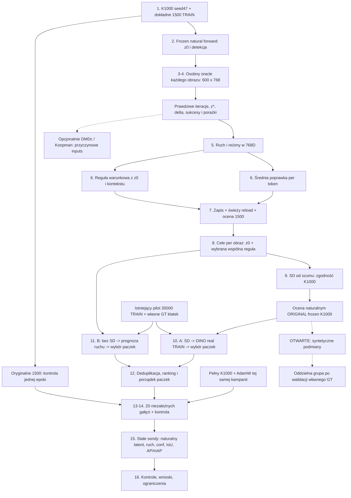

# Pełny pipeline K1000: cząsteczki, cele latentowe, SD, dobór danych i jedna epoka kontynuacji

Data dokumentacji: 2026-10-08. Repozytorium: `F:/Studia/PhD_projekt/VIT/ViTParticleFilterTracker/SmallViTAblation`.

**Status: plan przyszłych eksperymentów, oparty na istniejących materiałach. Sporządzenie tego dokumentu nie obejmuje treningu, uruchomienia oracle, generowania, indeksowania, zadania GPU ani zgłoszenia na klaster.** Dokument nie jest raportem wykonania całego pipeline'u. Historyczne wyniki mają własne źródła i zakres; oczekiwane artefakty są wymaganiami przyszłej realizacji.

Własność tej operacji obejmuje wyłącznie nowy katalog `plan_na_przyszle_eksperymenty/2026-10-08_k1000_pelne_czasteczki_dobor_danych/`. Nie zmieniamy istniejących eksperymentów, kodu, wyników, assets ani rejestru. Bez commitów. Inni agenci pracują równolegle: Hubble nad oracle i wzorcami, Nash nad pojemnością, Noether nad teorią. Ten dokument porządkuje cały zamysł i interfejsy, nie zastępuje ich implementacji ani audytów.

## 0. Statusy i dokładny zakres planu

- **USTALONE**: jawne wymaganie użytkownika lub fakt odczytany z evidence. Wymaganie nie oznacza osiągniętego wyniku. Fakty historyczne wskazują źródło.
- **REKOMENDACJA**: proponowana kontrola, estymacja lub organizacja, rozwijająca plan. Nie jest zatwierdzonym zastępstwem głównego eksperymentu.
- **OTWARTE**: brak rozstrzygnięcia, potrzebnego artefaktu, zgodności lub decyzji. Zależny etap może być zablokowany, podczas gdy niezależne etapy postępują.
- **EVIDENCE HISTORYCZNE**: wynik konkretnego pomiaru; nie prognoza rezultatu nowych testów.

**USTALONE:** osią planu jest oryginalny K1000, dokładnie jego 1500 oznaczonych obrazów i pełne cząsteczki 600×768. Najpierw zmieniamy latent przy zamrożonej sieci, potem uczymy wspólne reguły poprawki, tworzymy cele obrazowe, szukamy rzeczywistych danych dwiema drogami, a na końcu badamy rzeczywistą zmianę sieci po jednej epoce na zbiorze o stałej liczności 1500.

Nie występuje jeden wspólny oracle latent zastępujący wszystkie obrazy. Wspólny jest układ współrzędnych oraz późniejsza reguła korekty. Każdy obraz ma własny naturalny stan, cel i trajektorię oracle. Główne zadanie nie redukuje się do jednego obrazu,128 kanałów, średniej regionu, jednej sondy ani wizualizacji 3D.

### 0.1. Numerowana kolejność całego pipeline'u

1. Potwierdzić źródłowy K1000, jego kampanię, dokładną bazę 1500 i tożsamość wejść.
2. Zamrozić wagi i bufory; zmierzyć naturalny pełny latent oraz detekcję każdego obrazu.
3. Każdy obraz niezależnie optymalizować we wszystkich 600×768 współrzędnych do jednoczesnego confidence≥0,90 i IoU≥0,90, w skończonym budżecie.
4. Zapisać prawdziwą oś iteracji, trajektorie, z0, z*, delta, pierwszy sukces i porażki.
5. Opisać ruch 900000 cząsteczek w 768 wymiarach; znaleźć reżimy i nauczyć przypisanie z naturalnego stanu.
6. Zbudować średnią poprawkę per token i warunkową poprawkę reżimową. DMD/Koopman ze sterowaniem są poprawnie zdefiniowanymi kandydatami dodatkowej analizy.
7. Zapisać obie wykonywalne wersje K1000 ze wspólną korektą, świeżo wczytać i porównać na tych samych 1500.
8. Zachować cele per obraz: naturalny latent plus wybrana wspólna reguła; indywidualny oracle pozostaje osobnym odniesieniem.
9. Generować SD od losowego szumu przy zgodnym pełnotokenowym warunku lub prowadzeniu przez oryginalny K1000; oceniać obrazy naturalnym forwardem oryginalnego K1000.
10. Ramię A: do obrazów SD znaleźć rzeczywiste klatki w istniejącym pilotażu DINO35000 TRAIN, następnie wybierać paczki według prognozy aktualizacji.
11. Ramię B: ominąć SD i wybrać z tej samej puli rzeczywiste klatki według przewidywanego ruchu do celów.
12. Ustalić listy około 1500 unikalnych nowych klatek na ramię, ranking startowy, skład paczek i ich kolejność; zamrozić manifesty.
13. Przygotować wspólną kontrolę na oryginalnych 1500 oraz po dziesięć gałęzi podmiany dla A/B:150,300,...,1500.
14. Każdą gałąź rozpocząć od identycznego K1000 i pełnego autentycznego stanu AdamW; wykonać jednakowy zadeklarowany budżet jednej epoki.
15. Na początku i po epoce zmierzyć naturalny latent i detekcję na stałych 1500 sondach; rozdzielić odległość do celu, zgodność ruchu i AP/mAP.
16. Zestawić kontrole, niepowodzenia, koszty, ograniczenia i opcjonalnie odłożone filmy. Wyniki mają rozstrzygnąć użyteczność doboru.

### 0.2. Diagram zależności



## 1. Evidence i pochodzenie

Ścieżki w tabeli są względem repozytorium wskazanego na początku. Nie kopiujemy ciężkich danych do katalogu planu. Źródła mogą rozwijać się w pracy innych agentów; wykonawca utrwala ich hashe przed wykorzystaniem.

| ID | Odczytane źródło | Co rzeczywiście ustala |
|---|---|---|
| E01 | `assets/MalyViT_K1000_SD_conditioning/README.md`, `PROVENANCE.json` | Oryginalny K1000; kontener net, krok; input 480×320; latent 600×768; użycie do SD K1000 |
| E02 | `assets/MalyViT_K1000_SD_conditioning/MODEL_VIT_K1000.pt` | Lokalny SHA potwierdzony bez uruchamiania modelu |
| E03 | `experiments/maly_vit_ruch_czastek_gesta_historia/README.md` | Osobna kampania seed 47, baza 1500, batch 32, gęste tokeny i pełne stany optimizera |
| E04 | `experiments/maly_vit_ruch_czastek_gesta_historia/kod/trening.py`, `kod/bieg.py` | Grupy AdamW, LR, augmentacje, clip, tworzenie paczek, format pełnego checkpointa |
| E05 | `experiments/maly_vit_ruch_czastek_gesta_historia/wyniki/pelny/dane/metadata.json` | Historyczny status complete i seed 47 |
| E06 | `experiments/maly_vit_od_zera/eden/wejscia/pretrain/train/_annotations.coco.json` | Dokładne adnotacje; lokalny SHA potwierdzony |
| E07 | `experiments/maly_vit_nndmd_1500_obrazow_768/MANIFEST_1500.json` | verified, count 1500, exact_source_order, wszystkie TRAIN, ID i hashe źródeł; cache RGB i 101 checkpointów |
| E08 | `experiments/vit_k1000_1500_pelne_latenty_90_20261008/PLAN.md` | Plan oracle 500 rzeczywistych kroków, milestones i panel 256; nie raport sukcesów |
| E09 | `experiments/vit_k1000_1500_pelne_latenty_90_20261008/model_snapshot.py`, `korekta_model.py` | Hook bloki[-1].mlp.act; klasy MeanCorrection i RegimeCorrection; ich istnienie nie dowodzi skuteczności |
| E10 | `experiments/maly_vit_sufit_przewidywalnosci_100/WYNIKI_ROWNANIE_Z_PEDEM.md` | Pooled prognozy i retrospektywne granice z przyszłymi siłami |
| E11 | `experiments/maly_vit_odpowiedz_latentu_na_paczke/WYNIKI.md` | Wpływ paczki, pędu i sprzężenia zwrotnego; brak prostego składania długiej sekwencji |
| E12 | `experiments/vit_langevin_paczka32_cel_sztuczny/PLAN.md`, `WYNIKI_PODSUMOWANIE.md` | Autentyczny optimizer; dobry pierwszy przyrost nie dał celu w 50 krokach |
| E13 | `experiments/vit_langevin_planowanie_paczek_sd/PLAN.md`, `WYNIKI.md` | Dynamiczny greedy horizon 1, cztery paczki 32, porównanie z losowaniem/cyklem, pogorszenie detekcji sondy |
| E14 | `experiments/vit_dino_faiss_35000/README.md`, `PLAN.md`, `DINO_SPEC.json` | Pilot TRAIN, DINOv 2 ViT-S/14,384 D CLS, preprocessing i QA |
| E15 | `outputs/vit_dino_faiss_35000/PROGRESS.json` i lista plików | processed 35000/total 35000,35 chunków; status nadal running/extract, brak index.faiss i RAPORT.md w lokalnym odczycie |
| E16 | `experiments/vit_sd_pelny_latent_filmy_eden_20261006/README.md` | SD K1000: adapter pełnych 600 tokenów, naturalny warunek, rozdział skal ViT/VAE |
| E17 | `experiments/vit_sd_od_zera_k8000_filmy_20261006/README.md` | Inna kampania, teacher K8000 i generatywne wagi od zera; brak automatycznej zgodności K1000 |
| E18 | `outputs/audyt_miejsca_eden_20261008_latenty1500/` | Istniejące audyty pojemności/kopii; nie bieżąca gwarancja miejsca |

**OTWARTE:** finalnego lokalnego raportu DINO nie znaleziono w tym odczycie. 35000 przetworzonych wierszy nie dowodzi zakończonego zapisu i QA indeksu. Snapshot progress nie dowodzi, że historyczny PID nadal działa. Przed użyciem sprawdzić gotowy indeks, wiersze, hashe i reload, bez automatycznego uruchamiania nowej ekstrakcji.

### 1.1. Kotwice integralności

**USTALONE, lokalnie potwierdzone:**

```text
K1000 SHA256:
3df42a6adc1c47075a52f85641772e19be430280a7d27e0f6635b6753db4649e
COCO bazy1500 SHA256:
3667dd12c8fddcb695c9ce6144ca4bf3f5300f70a47322a8da12b92de6d98f75
```

E07 deklaruje cache `experiments/maly_vit_od_zera/cache/baza1500.npy`, shape `[1500,320,480,3]`, SHA `56837dcf3268e11664302874ce465bcf7ad47a94d54ab5e69817c1137ccfd789`. Hash cache przytoczono z manifestu, bez świeżego hashowania całego pliku i wszystkich obrazów. W E07 checkpoint k 1000 ma ten sam SHA co asset.

Pierwszy rekord: index 0, image_id 0, `cataract_lmm/tracking/TR_0001_S1_P03/00000076`, TRAIN, źródłowe GT XYWH `[336,273,180,17]`. `segmentation_available=false`. Nie dopisywać nieistniejących masek. Konwersja XYWH→XYXY i skalowanie bbox po resize są jawne.

### 1.2. Historia przed nowym planem

1. Mały hybrydowy ViT uczono od zera w osobnej kampanii `2026-10-01_maly_vit_ruch_czastek_gesta_historia`, seed 47, baza 1500. K1000 oznacza 1000 aktualizacji, nie epok.
2. Historyczny `LATENT_GESTY.npy` miał shape `(1001,12,600,768)`, a inne odczyty dotyczyły 192 średnich sond. To nie pełne historie wszystkich 1500.
3. Wagi zapisywano co 10, pełny stan AdamW co 100. Częstość historii tokenów nie jest częstością pełnych checkpointów.
4. K1000 pozostaje niezmiennym assetem. Indywidualnie wyoptymalizowany latent jest artefaktem aktywacji, a nie zmienionymi wagami.
5. Kampanie K8000 i różne SD nie są równoważne z K1000. Architektura o tym samym shape nie daje zgodności reprezentacji.
6. Historyczny Langevin jest evidence ograniczonego zadania. Nowy pełnotokenowy test 1500 musi być sprawdzony osobno.

## 2. Cząsteczki, mapowanie i trzy rodzaje czasu

**USTALONE:** `Z_i^0 ∈ R^(600×768)` to naturalny latent obrazu i. Token p jest cząsteczką `z_(i,p) ∈ R^768`. Siatka ma 20 wierszy×30 kolumn przy wejściu 320×480 i skoku 16 px. 600 to przestrzenne tokeny, nie batche.

768 to szerokość ukrytej aktywacji ostatniego MLP po GELU. Residual stream tego snapshotu ma 192 wymiary. Hook: `model.bloki[-1].mlp.act`, przed fc 2. Końcowy residual 192 nie jest żądanym latentem 768.

Makrowektory e_j to wspólne 768 kierunków bazowych. Mikrowektory cząsteczki są składowymi z_j e_j; model przechowuje współrzędne z_j, nie osobne wielowymiarowe wektory wewnątrz tokenu. Globalny układ nie oznacza średniej wszystkich tokenów.

900000 cząsteczek=1500×600. Jedna migawka zawiera 691200000 współrzędnych. Trajektoria ma dodatkową oś czasu.

| Indeks | Znaczenie | Zasada |
|---|---|---|
| i | Ten sam obraz referencyjny | Nie podmieniamy jego tożsamości w pomiarze ruchu |
| p | Ten sam token, row/column | Nie tasujemy patchy między stanami |
| j | Kanał wspólnej bazy 768D | Zachowujemy kolejność współrzędnych |
| s | Aktualizacja aktywacji oracle | Wagi/bufory K1000 są stałe |
| k | Aktualizacja wag podczas treningu | Zmieniają się wagi i bufory sieci |
| tau | Timestep denoisingu SD | Nie jest s ani k |

Przejście między różnymi obrazami nie jest krokiem czasu jednej cząsteczki. Oracle zmienia aktywacje, a późniejszy trening zmienia sieć; to odmienne procesy i odmienne optimizery.

## 3. Krok 1: model, dokładne 1500 i freeze

### 3.1. K1000

**USTALONE:** użyć E01/E02, krok 1000, właściwy SHA, strict load całego net. Nie zastępować checkpointem po dopasowaniu do jednej sondy, K8000, RF-DETR ani modelem o podobnej nazwie.

1. Utrwalić ścieżkę, SHA, rozmiar, architekturę i wersje zależności.
2. Zidentyfikować wszystkie parametry i bufory, szczególnie BatchNorm łodygi.
3. W etapach oracle, korekty i generacji ustawić eval, zamrozić parametry i running statistics.
4. Oracle potrzebuje autograd względem aktywacji. Frozen weights nie oznacza wyłączenia gradientów Z.
5. Hash stanu przed/po. Zmiana buforów unieważnia frozen porównanie.
6. Inferencja i przyszłe kopie do treningu są oddzielne; żadnego zapisu pod nazwą assetu.

### 3.2. Dokładna baza

**USTALONE:** lista images właściwego COCO w oryginalnej kolejności. Dowolne 1500 z tego datasetu nie jest tą bazą.

1. Sprawdzić liczbę, GT, image_id, film/frame, split, bbox format i hashe źródeł.
2. Zachować dekodowanie RGB, resize i zgodność cache ze źródłami deklarowaną przez E07.
3. InputViT480×320 i normalizacja snapshotu. Bez pomyłek RGB/BGR ani H/W.
4. Poprawnie skalować GT z rozdzielczości źródłowej.
5. Wadliwy rekord dostaje jawny defekt. Nie podmieniamy obrazu pod tym samym indeksem ani nie usuwamy go po wyniku.
6. Immutable manifest 1500 i jego hash są wspólne dla oracle, oceny korekt i stałych sond po treningu.

**REKOMENDACJA:** manifest zawiera annotation_id, klasę, źródłowe i przeskalowane bbox, token docelowy, wersję dekodera i mapę siatki. Chroni to przed osiągnięciem 90/90 względem niewłaściwego GT.

## 4. Krok 2: naturalny punkt startu

1. Naturalny forward frozen K1000 bez podmiany aktywacji.
2. Zapis pełnego Z0, shape i mapowania tokenów.
3. Confidence, top-1 komórka, przewidywany bbox i IoU względem właściwego GT.
4. Naturalne AP/mAP tym samym ewaluatorem co dalej.
5. Lista obrazów już spełniających oba progi; first_success może wynosić 0.
6. Powtarzalność odczytu i niezmienność modelu.

**USTALONE:** naturalny latent jest kontrolą zerowej interwencji. Historyczne confidence 0,8678695 i IoU0,8565946 jednej sondy z E01 nie są średnią 1500 ani mAP. AP50=61,12 procent osobnego K8000 nie przypisujemy K1000.

**REKOMENDACJA:** zamrozić decode i definicję właściwego top-1 przed oracle. Wysoki logit dowolnej komórki nie jest sukcesem; oba progi muszą dotyczyć tej samej właściwej detekcji.

## 5. Krok 3: osobny pełny oracle każdego obrazu

### 5.1. Zmienna i cel

**USTALONE:** osobny `Z_i(s)` shape 600×768, start Z_i(0)=Z_i^0, wszystkie współrzędne są optymalizowane. Dawny wybór 128 kanałów nie definiuje głównego testu.

```text
confidence właściwej wybranej detekcji >= 0.90
IoU tej samej detekcji względem GT_i >= 0.90
oba warunki w tym samym faktycznie odwiedzonym stanie
```

Wagi i bufory nie zmieniają się. Za hookiem działa prawdziwy ogon: fc 2, LayerScale/dropout zgodny z eval, residual obrazu, końcowy LayerNorm i głowa. Sam Z nie zastępuje residualnego kontekstu. Fast tail jest dopuszczalny tylko po zgodności z pełnym hook-forwardem dla tego samego obrazu.

**REKOMENDACJA zgodna z E08:** loss łączy target logit, tłumienie konkurentów, ranking top 1, bbox/G IoU i małą normę zmiany. Wagi składników, optimizer, preprocessing i schedule są wspólne i zapisane przed biegiem. GT jest dostępne: to jawny oracle, nie GT-free detekcja.

### 5.2. Budżet i prawdziwa oś iteracji

**USTALONE:** skończony budżet, bez obietnicy 1500 sukcesów. Brak 90/90 zostaje w mianowniku 1500.

E08 obecnie opisuje 500 rzeczywistych kroków per obraz, Adam LR0,05 w 1-100, 0,15 w 101-250, 0,05 w 251-400, 0,01 w 401-500; karę `1e-6*mean((Z-Z0)^2)`; dolny clamp post-GELU około−0,16997121. Po sukcesie nadal wykonuje kroki, minimalizując normę pod barierami progów. To odczytana konfiguracja implementacji Hubble'a, nie dowód wykonania ani nakaz zapisu 500 pełnych snapshotów.

**OTWARTE:** finalny horyzont i stride/milestones wiążemy z czasem, kwotą i wersją implementacji. Nie ustalać automatycznie 100 kroków. Clamp wymaga właściwej wersji GELU; nawet poprawny clamp nie dowodzi naturalności latentu.

1. s=0 jest stanem przed pierwszą aktualizacją, s=1 po pierwszej. Numery oznaczają faktyczne kroki, nie numery zapisanych plików.
2. Każdy obraz ma własny optimizer, momenty i status. Batche wykonawcze nie mieszają tych stanów.
3. first_success zapisujemy w chwili pierwszego sukcesu; selected_step i last_step są osobne.
4. Wspólne snapshoty mają te same rzeczywiste numery iteracji.
5. Dalszy przebieg po sukcesie obejmuje realne aktualizacje według jawnej reguły.
6. Przy earlystop dalszy timeline jest brakujący, nie dopełniony powtórzonym końcem.
7. Przedkrokowy gradient/momenty mają jednoznaczne timestampy względem Z_s i Z_(s+1).
8. Stride nie zmienia liczby aktualizacji. Koniec obrazu i początek następnego nie tworzą przejścia dynamiki.

### 5.3. Cel końcowy i porażki

**REKOMENDACJA z E08:** Z_i* jest faktycznie odwiedzonym stanem 90/90 o najmniejszej zadeklarowanej normie korekty. Zachować stan pierwszego sukcesu i końcowy; mogą się różnić.

Dla braku sukcesu zachować najlepszy odwiedzony stan według zapisanej wcześniej hierarchii i status budget_exhausted. Nie nazwać go 90/90. Błędy numeryczne, brak źródła/GT i ograniczenie geometrii są odrębnymi statusami.

Sukces może być nienaturalnym rozwiązaniem aktywacyjnym; brak sukcesu może wynikać z geometrii głowy. Nie zmieniać po fakcie progów ani GT. Jeden brak sukcesu obala „wszystkie 1500 osiągnęły progi tym protokołem”, nie globalną możliwość przy dowolnym budżecie.

### 5.4. Zapis per obraz

| Pole | Zawartość |
|---|---|
| image_id, film, frame, source_sha | Tożsamość wejścia |
| checkpoint_sha, manifest_sha, config_sha | Tożsamość aparatu |
| layer, shape, grid, channel_order | Pełne mapowanie 600×768 |
| z0, z_star, delta | Pełne endpointy; delta=z_star-z 0 |
| trajectory_steps, trajectory_states | Rzeczywiste numery iteracji i odpowiadające stany |
| first_success_step, selected_step, last_step | Pierwszy sukces, wybrany cel i wykonany budżet |
| metrics_per_step | Loss, conf, IoU, top 1, normy, norma gradientu, faza |
| success, failure_reason | Także porażki i niekompletność |
| target_annotation_id, target_token | Właściwe GT i dopasowanie |
| optimizer_config, resume_state | Reprodukcja i prawdziwe wznowienie |

**REKOMENDACJA:** gęsta mała telemetria każdego kroku, pełne stany według budżetu i gęsty panel diagnostyczny. Panel 256 tokenów nie jest pełną gęstą trajektorią 900000 cząsteczek.

## 6. Krok 4: kontrole i zamknięcie oracle

1. Naturalny forward i identity hook Z=Z0 mają być zgodne.
2. Fasttail i pełny hook-forward mają się zgadzać na naturalnych i zmienionych stanach.
3. Świeżo wczytać endpoint i ponownie zmierzyć progi. Same metryki sprzed serializacji nie wystarczają.
4. Hash wszystkich wag i buforów przed/po musi pozostać taki sam.
5. Wszystkie 1500 mają status, niekoniecznie sukces. Count manifestu nie jest successcount.
6. Scalanie sprawdza rozłączność shardów, kompletność 0-1499 i brak duplikatów.

**REKOMENDACJA:** placebo o podobnej normie, np. przemieszanie przypisania delta do obrazów/patchy, mierzy znaczenie dopasowania. Jawnie opisać zachowane i zniszczone własności. Placebo nie zastępuje naturalnej kontroli.

## 7. Krok 5: ruchy i reżimy 900000 cząsteczek

### 7.1. Opis pełnowymiarowy

**USTALONE:** zachować wspólną bazę 768D. Dla każdego `(i,p)` opisać z0, delta, normę, kierunek, przebieg i status obrazu. Kierunek normalizować tylko przy normie powyżej zadeklarowanego epsilon; ruch zerowy jest osobnym przypadkiem.

1. Rozkłady norm zmian per obraz, patch i kanał, również względem energii naturalnego tokenu.
2. Cosinusy kierunków przemieszczeń i ich skupienia w 768D.
3. Zależność od z0, pozycji patcha, naturalnego kontekstu i jakości detekcji startowej.
4. Stabilność i odwrócenia kierunku na rzeczywistych odcinkach trajektorii.
5. Różnice sukcesów i porażek. Nie usuwać trudnej grupy z powodu niespełnienia progów.
6. Reżimy: liczność obrazów/tokenów, rozrzut norm/kierunków, lokalizacja i wymagane wejścia przypisania.

**REKOMENDACJA:** rozdzielić bloki cech z0, kierunek jednostkowy i magnituda; zadeklarować ich skale. Wielka amplituda nie powinna automatycznie być interpretowana jako semantyczny reżim. Obrazy mają równy wkład;900000 zależnych tokenów nie jest 900000 niezależnych próbek.

Rzut 3D może ilustrować strukturę, ale nie jest modelem globalnego układu. Redukcję numeryczną 768D→r do clusteringu/regresji trzeba ujawnić, zapisać transformację i błąd odtworzenia. Poprawki i główna ocena pozostają pełne 600×768.

### 7.2. Reżim opisowy a wykonywalne przypisanie

**USTALONE:** przyszła oracle delta może być etykietą na etapie fit. Przy zastosowaniu reguły na naturalnym obrazie nie wolno podawać jego delta, z*, przyszłego ruchu ani statusu osiągniętego po optymalizacji.

Można odkryć klastry na `(z0,direction,magnituda)`, a następnie nauczyć przypisanie tylko z naturalnego z 0 i dostępnego kontekstu. Jakość tego predyktora mierzyć osobno. Ewaluacja z prawdziwą etykietą reżimu wyznaczoną z przyszłego celu to oracle-assignment, nie wykonywalna wspólna korekta.

**OTWARTE:** liczba reżimów, metoda klastrowania, cechy, regularizacja i kalibracja. Klasa RegimeCorrection z E09 używa projekcji naturalnego z0, pozycji patcha i średniego kontekstu obrazu. Średnia kontekstu jest cechą, nie definicją globalnej przestrzeni. Istnienie klasy nie potwierdza skuteczności.

**REKOMENDACJA:** stabilność clusteringu na różnych seedach; dodatkowo podział po filmach przy wyborze liczby reżimów. Główna ocena 1500 jest in-sample. Opcjonalny GroupKFold uczy wszystkie skalery, projekcje, reżimy i poprawki tylko na fit danego folda, nie na całych 1500 przed podziałem.

## 8. Krok 6: dwa wspólne modele korekty

Nazwy `C_mean` i `C_regime` odróżniają poprawki od ramion selekcji A/B. Nie mieszać średniej poprawki z drogą A przez SD.

### 8.1. C_mean: średnia po obrazach, osobno per token

**USTALONE:**

```text
mean_delta[p,j] = mean_i(delta_i[p,j])
Z_mean(i) = Z0(i) + mean_delta
shape(mean_delta) = [600,768]
```

To nie jeden wektor 768 po uśrednieniu patchy. Każdy z 600 przestrzennych indeksów ma własną poprawkę 768D wspólną po obrazach. Zachowujemy p→(row, column).

**OTWARTE:** populacja fit przy porażkach oracle: wszystkie najlepszych stanów, tylko sukcesy czy jawne wagi. Propozycja: jedna wcześniej zadeklarowana główna populacja, a success-only jako osobna analiza z liczbą wykluczonych. Średnia częściowych/najlepszych stanów bez sukcesu delta nie może być opisana jako średnia 1500 celów 90/90.

### 8.2. C_regime: warunkowa poprawka

**USTALONE:** reguła przy użyciu widzi tylko naturalne informacje.

```text
r(i,p) = assign(z0(i,p), position(p), natural_context(i))
delta_hat(i,p) = correction(r(i,p), p, natural_features)
Z_regime(i) = Z0(i) + delta_hat(i)
```

**REKOMENDACJA:** średnia reżim×patch z kurczeniem do średniej reżimu/C_mean przy małej liczności. Alternatywa: jawny regresor warunkowy. Zapisujemy parametry, scalery i schemat wejść. Większa liczba parametrów może poprawić in-sample fit, ale nie dowodzi uniwersalnych wzorców ruchu.

Jeśli stosujemy ograniczenie domeny P, raportujemy efektywną korektę `P(Z0+delta_hat)-Z0`. Po clamp rzeczywista poprawka nie musi równać się surowej średniej.

### 8.3. DMD, DMDc i Koopman: opcjonalni kandydaci

**REKOMENDACJA:** DMD opisuje ewolucję bez jawnych inputs; DMDc rozdziela stan i sterowanie w przybliżeniu `q(s+1)=Aq(s)+Bu(s)`. Rozdzielenie to opisują [Proctor, Brunton i Kutz](https://arxiv.org/abs/1409.6358). Nie gwarantuje trafności dla nieliniowego optimizera aktywacji.

[PyDMD DMDc](https://pydmd.github.io/PyDMD/dmdc.html) przyjmuje snapshoty i dane sterowania. Jest konkretnym kandydatem. [deeptime DMD](https://deeptime-ml.github.io/latest/api/generated/deeptime.decomposition.DMD.html) obsługuje dopasowane pary dla DMD; tej klasy nie nazywamy gotowym DMDc bez osobnego interfejsu inputs. Wersje i możliwości potwierdzić w środowisku realizacji. Dokument nie instaluje bibliotek.

1. Każda para ma te same image_id/token_id i prawdziwe s, s+1 lub jawne lag.
2. u_s może zawierać gradient dostępny przed aktualizacją, momenty, licznik i schedule. Jeśli gradient korzysta z GT, wynik jest warunkową prognozą oracle, nie GT-free inference.
3. **Zakaz leakage:** u_s równe `z(s+1)-z(s)` albo końcowa delta przewidująca samą siebie nie są uczciwymi inputs.
4. Sam z_s może nie domykać Adama. Stan powinien uwzględniać momenty, krok i fazę celu albo jawnie opisać aproksymację.
5. Panel 256 tokenów zasila analizę panelową; nie potwierdza 900000.
6. Nie tworzymy przejść pomiędzy obrazami. Split uwzględnia obraz/film i bloki czasu.
7. Prognozę porównujemy z brakiem zmiany i prostym baseline. Rollout korzysta z własnych prognoz i dostępnych inputs, nigdy przyszłych rzeczywistych stanów.
8. Milestones 25/100/500 nie są trzema kolejnymi równymi krokami. Potrzebny jawny lag albo model czasu.
9. Redukcja r i odtworzenie 768D są jawne. implementacja CPU nie staje się przyspieszana przez GPU przez samo użycie klastra.
10. To dodatkowy test; nie zastępuje obowiązkowych C_mean/C_regime.

## 9. Krok 7: wykonywalne pakiety K1000 z poprawkami i świeży odczyt

**USTALONE:** zapisać co najmniej frozen K1000+C_mean oraz frozen K1000+C_regime. Pakiet wylicza naturalny latent kompatybilnego obrazu i stosuje regułę bez pobierania indywidualnego oracle tego obrazu.

1. Oryginalne wagi/bufory lub niezmienne odwołanie z SHA; architektura, parametry poprawki, P, scalery/centroidy i schemat cech.
2. Nie nadpisujemy K1000. Korekta aktywacyjna nie jest nowymi wyuczonymi wagamiViT.
3. Świeży proces wczytuje pakiet bez tensorów pozostałych po fit.
4. Wszystkie 1500 przechodzą naturalny forward i wspólny hook. Nie podstawiamy ich z*.
5. Osobne wyniki: naturalny K1000, C_mean, C_regime i indywidualny oracle reference.
6. Błąd shape, parametrów lub reload jest błędem artefaktu, nie wynikiem naukowym.

**USTALONE:** per-image conf/IoU i zbiorcze AP/mAP; counts lepiej, gorzej, both 90. Dla conf i IoU osobno wzrost/spadek/remis z ustaloną tolerancją. Dodatkowo oba lepiej, oba gorzej, wynik mieszany i remisy. Wzrost confidence przy spadku IoU nie jest jednoznaczną poprawą.

AP wymaga właściwego matching, rankingu, list detekcji, recall i polityki NMS; nie jest średnią confidence/IoU. Raportować AP50 oraz, jeśli aparat obsługuje, AP50:95. Przy jednej klasie średnia po klasach może równać sięAP, lecz IoUsweep i nazwa nadal muszą być jawne.

**USTALONE:** ocena na tych 1500 użytych dooracle i fit jest dopasowaniem in-sample. **REKOMENDACJA:** dodatkowa ocena na filmach odłożonych w fit może sprawdzić transfer, ale nie usuwa głównego testu użytkownika.

## 10. Krok 8: cele każdego obrazu referencyjnego

**USTALONE:** pełny cel jest indywidualny, ale wyprowadzony ze wspólnej reguły:

```text
T_mean(i) = P(Z0(i) + delta_mean)
T_regime(i) = P(Z0(i) + delta_hat(Z0(i), context(i)))
T_oracle(i) = Z_star(i)  # oddzielny reference
```

P jest identity, jeśli brak ograniczenia. Jeśli klasa korekty zwraca już gotowy latent, nie dodawaćZ0 ponownie.

1. Zachować image_id, sourceSHA, teacher SHA, mapowanie tokenów i pełny shape 600×768.
2. Zapis metody, wersji reguły i realnego wyniku poP.
3. Indywidualny oracle nie jest automatycznie głównym celem generacji. To osobne uprzywilejowane odniesienie.
4. Cele pozostają zamrożone podczas późniejszego treningu. Sondy mają zbliżać się do celu z K1000, nie do stale przesuwanego punktu.
5. Nie normalizować magnitudy bez deklaracji i mapowania skali.

**OTWARTE:** wybór wspólnej reguły dla głównego SD i obu ramion. Minimalne 20 gałęzi zakłada jeden wybrany zestaw celów. Skrzyżowanie dwóch reguł×dwóch ramion×dziesięciu podmian daje 40 gałęzi, nie 20; jest rozszerzeniem budżetu.

## 11. Krok 9: SD od losowego szumu

### 11.1. Co jest zadaniem generacji

**USTALONE:** generować bezpośrednio od losowego szumu, nieimage 2 image. Obraz referencyjny dostarcza naturalnego latentu/celu, identyfikatora i odniesienia, lecz jego piksele nie są startowym obrazem denoisingu. Dla każdego celu kilka seedów, a docelowo rozważana pula około 1500 wygenerowanych kandydatów.

1. Utrwalić target_i, jego metodę i mapping 600×768.
2. Wylosować początkowy szum zgodny zVAE/samplerem danego modelu.
3. Wykonać denoising pełnotokenowo kompatybilnym warunkiem albo prowadzeniem.
4. Zdekodować VAE, wykonać dokładny preprocessing K1000 i naturalny odczyt.
5. Zapisać obraz, seed, config, target ID, naturalne latenty i osobne metryki.
6. Wybrać kandydata według z góry jawnej polityki. Zachować także odrzucone i powody.

**OTWARTE:** kilka seedów na każdy z 1500 celów może oznaczać np.S×1500 prób i wybór 1500 finalistów albo kilka seedów na mniejszym panelu, a potem produkcję 1500. Liczba prób i liczba zaakceptowanych kandydatów to różne budżety. Niedobór jakości/unikalności jest jawnym wynikiem, nie powodem kopiowania obrazów dla uzyskania count 1500.

### 11.2. Zgodność K1000 i modeli generatywnych

**USTALONE:** wszystkie 600 tokenów celu muszą być kompatybilne z użytym teacherem/adapterem. Shape 600×768 nie dowodzi zgodności semantycznej między K1000 i K8000.

E16 opisuje kampanię pełnolatentową K1000: adapter Linear/GELU/Linear 768→768→768 per token, pozycje 20×30, bez poolingu, z zamrożonym K1000. To kandydat naturalnie zgodny po potwierdzeniu provenance checkpointa.

E17 używa teachera K8000 iVAE/UNet/adaptera od losowych wag. Nie wolno bez sprawdzenia włożyćT_K1000 do adaptera K8000 i nazywać tego zgodnym prowadzeniem K1000.

**OTWARTE:** asset `assets/StableDiffusionModel/best_checkpoint.pt` istnieje, lecz sama nazwa/obecność nie rozstrzyga teacher SHA, konfiguracji adaptera iVAE. Przed użyciem odczytać metadane i wskazać konkretną kampanię.

Dopuszczalne rozwiązania:

1. Zweryfikowany model SD i pełnotokenowy adapter uczony z oryginalnym K1000.
2. Jawny kompatybilny adapter między reprezentacjami, z własnym fit i walidacją. To dodatkowy eksperyment, nie już dostępna gwarancja.
3. Generator może używać innego warunku, ale gradient guidance przechodzi przez frozen oryginalny K1000 na zdekodowany obraz i porównuje pełny naturalny latent doT_K1000. Wagi K1000 nie są uczone; autograd obrazu musi pozostać aktywny. Samo porównanie po generacji nie jest gradient guidance.

Brak zgodności zatrzymuje etap SD, nie uzasadnia zmiany bazowego modelu na K8000. RamięB może przygotowywać się niezależnie.

### 11.3. Parametry, VAE i naturalność

**USTALONE:** polecenie „nie przekraczać naturalnych parametrów SD” interpretujemy jako pozostawanie w prawidłowym zakresie ustawień/modelu, nie jako matematyczny dowód pozostania na manifoldzie naturalnych obrazów.

1. Konfiguracja UNet, liczba kanałów, wymiar warunku, resolution i wymagane dodatkowe kanały zgodne z checkpointem.
2. VAE, jego współczynnik skalowania, encode/decode i zakres pikseli zgodne z tym checkpointem; nie zakładać 0,18215 dla każdego modelu od zera.
3. Scheduler/sampler, typ predykcji, timesteps, liczba kroków, eta i guidance zapisane i kompatybilne z treningiem generatora.
4. Osobne resize: SD może pracować 384×576, K1000 na 320×480. Zachować mapowanie i nie mylić siatkiVAE z 600 tokenami ViT.
5. Kontrola wartości skończone, clipping, bandingu, artefaktów, powtórzeń, kolorów, geometrii narzędzia i sceny.
6. **REKOMENDACJA:** ślepa ocena wizualna kilku seedów oraz porównanie naturalnego warunku z poprawionym celem przy tym samym seed/samplerze.

Nawet pełna zgodność latentowa nie gwarantuje poprawnych pikseli, realistyczności, etykiet GT ani użyteczności treningowej. Guidance może znaleźć adversarial obraz; wartość detektora i jakość wizualna są odrębne.

## 12. Ocena obrazów SD bez kołowej metryki

**USTALONE:** ocenia oryginalny frozen K1000 naturalnym forwardem, bezC_mean/C_regime i bez hooka oracle. Gdyby ocena podmieniała latent na cel, mierzyłaby wprowadzoną interwencję zamiast jakości obrazu generowanego.

Dla target_i i wygenerowanego obrazu Xgen wyliczamy `Zgen=K1000.lastMLP.act(Xgen)`.

```text
MSE_full = mean_{p,j} (Zgen[p,j] - T_i[p,j])^2
cos_target[p] = dot(Zgen[p],T_i[p]) / (norm(Zgen[p])*norm(T_i[p]))
desired_move[p] = T_i[p] - Z0_i[p]
generated_move[p] = Zgen[p] - Z0_i[p]
cos_progress[p] = cos(generated_move[p], desired_move[p])
```

**USTALONE:** cos(Zgen, T) mierzy zgodność położenia, a cos(Zgen−Z0, T−Z0) zgodność kierunku ruchu. Nie utożsamiać obu. Dodatkowo osobno można mierzyć ruch wobec `Z_star-Z0`, ale oznaczyć go postęp względem oracle, nie wspólnym postęp względem wspólnego celu.

**REKOMENDACJA:** normratio, projekcja postępu `dot(move,desired)/norm(desired)^2`, residual ortogonalny i redukcja MSE wobecZ0. Ujemna projekcja to ruch przeciwny, wartość>1 może oznaczać overshoot, a nie automatyczny sukces. Zero desiredmove lub zerowa energia daje jawny undefined, nie sztuczny cosinus 1.

Raport obejmuje per token rozkłady i agregaty per image, nie sam cosinus spłaszczonego tensora dominowany wysoką energią. MSE icos pozostają oddzielnymi metrykami.

Confidence wygenerowanego obrazu można zmierzyć naturalnie. **IoU wymaga rzeczywistego GT tego obrazu.** Bbox referencji można użyć jako nominalnego warunku/diagnostyki zgodności geometrii, z taką nazwą, ale nie jako automatycznie prawdziwego GT nowej sceny. Przed deklaracją AP dla syntetyków lub both dla syntetyków 90 wymagana walidacja/annotacja.

## 13. Krok 10: ramię A, SD → DINO → rzeczywiste klatki

**USTALONE:** użyć istniejącego pilota 35000 TRAIN. Nie rozszerzać automatycznie do całego datasetu. Do zapytania SD użyć dokładnej specyfikacji indeksu:

- DINOv 2 `dinov2_vits14`, bez register tokens,384 DCLS, L2 normalizacja FP32.
- RGB, Resize shorter 256 BICUBIC, CenterCrop 224, ToTensor i mean/std zDINO_SPEC.
- Ten sam SHA wag i schema descriptoru. Historyczny cache CLS+maxpatch nie jest zamiennikiem.

1. Zweryfikować gotowość indeksu i mapęrow→archive/member→film/frame→GT.
2. Zakodować obrazy SD tym samym preprocessingiem; wyszukać topK rzeczywistych sąsiadów.
3. Odczytać prawdziwe GT każdego realnego kandydata z jego annotation CSV/manifestu.
4. Odrzucić zły split, uszkodzenie, brak poprawnej ramki narzędzia i niedopuszczalny overlap.
5. Zachować dla każdego trafienia query ID, target ID, rank, score DINO, ID realnego obrazu iźródło GT.
6. Deduplikować globalnie po wszystkich zapytaniach. Jedna klatka odnaleziona przez 100 zapytań nie jest 100 nowymi obrazami.
7. Utrwalić różne pule kandydatów i wybrać kompletne paczki przy użyciu prognozy aktualizacji w rozdziale 15.
8. Dążyć do około 1500 unikalnych rzeczywistych obrazów. Przy niedoborze zgłosić insufficient_unique_candidates; nie wypełniać duplikatami.

**USTALONE:** trening głównego ramienia A korzysta z rzeczywistych znalezionych klatek i ich własnego GT. SD jest zapytaniem/propozycją, nie domyślnym obrazem treningowym.

**REKOMENDACJA:** adaptacyjnie zwiększać topK wyłącznie wewnątrz 35000 z wcześniejszym limitem. Rejestrować efekty deduplikacji, liczbę filmów i temporalną bliskość klatek. DINO CLS może opisywać tło; podobieństwo DINO nie dowodzi zgodności 600×768 ani korzyści z uczenia.

## 14. Krok 11: ramię B bez SD, selekcja z 35000 po przewidywanym ruchu

**USTALONE:** ta sama pula 35000 TRAIN i prawdziwe GT, bez wymogu generowania obrazu SD. Wybór opiera się na przewidywanym skutku aktualizacji względem ustalonych celów, nie wyłącznie na obecnej odległości latentu kandydata odtargetu.

1. Zweryfikować ten sam manifest, splits, deduplikację i politykę overlap.
2. Zbudować kandydatów i kandydackie paczki z rzeczywistym GT.
3. Przy wspólnym stanie K1000+AdamW policzyć gradient/aktualizację i prognozowany ruch stałych sond.
4. Nadać score według zadeklarowanej metryki doT_i oraz tie-break.
5. Utrwalić ranking, skład i kolejność całych paczek.
6. Wybrać około 1500 unikalnych klatek; niedobór pozostaje jawnym ograniczeniem.

**REKOMENDACJA:** tańszy prefilter pełnopulowy jest możliwy, ale trzeba pokazać jego recall, liczbę odrzuconych i wpływ na budżet selekcji. Nie deklarować pełnego gradientowego przeszukania wszystkich 35000, jeśli gradienty policzono tylko małej części.

Ramię A i B są dwiema drogami do rzeczywistych danych. Mogą mieć częściowo wspólnych zwycięzców; międzyramienny overlap trzeba zmierzyć, a nie zakazywać arbitralnie. Wewnątrz każdego zbioru treningowego wymagana unikalność.

## 15. Wspólny mechanizm selekcji: gradient, AdamW i Langevin jednego kroku

### 15.1. Co jest prognozowane

**USTALONE:** zamierzona selekcja używa skutku aktualizacji całej sieci na właściwej paczce z GT i pełnej pamięci AdamW. Cel odnosi się do naturalnych pełnych latentów stałych obrazów referencyjnych. Nie stosujemy hooka oracle podczas realnego uczenia.

```text
current state = theta, buffers, AdamW state, global_step
candidate batch B with real GT -> loss -> clipped gradient g_B
compatible AdamW update -> predicted parameter increment dtheta_B
predicted natural probe motion -> score relative to fixed targets T_i
decision sealed BEFORE the actual training update
```

1. Kopie/funkcjonalne obliczenia nie mogą modyfikować modelu startowego ani buforów podczas rankingu.
2. Gradient w trybie train może wymagać skopiowanych buforów BN, tych samych augmentacji i bf16 co uczenie. Naturalne sondy oceniamy w eval.
3. Zachować grupy parametrów, momenty, betas, eps, LR, weightdecay, licznik kroku i clipping. Świeży AdamW nie odtwarza pędu K1000.
4. Równanie może przybliżać pchnięcie nowej paczki, pęd, zanikwag i inne składniki. Pominiętą nieliniowość/BN raportować.
5. Horyzont 1: korzystamy z obecnego stanu i znanej kandydującej paczki. Jej gradient jest obliczalny przed decyzją.
6. Rzeczywisty przyszły gradient w nowym, jeszcze nieosiągniętym stanie nie jest dostępną cechą. Znana lista batchy nie daje ich gradientów po drodze.
7. Z0/T/delta indywidualnego obrazu kandydata nie mogą maskować niedostępnego przyszłego skutku treningu; ewentualne nadzorowanie score musi być jawne.

**OTWARTE:** score agreguje wszystkie 1500 sond czy etapowy panel z późniejszym pełne ponowne wyliczenie rankingu. Pełne 1500×600×768 przy wielu paczkach jest kosztowne; panel jest aproksymacją i wymaga audytu zgodności z pełną oceną.

**REKOMENDACJA:** główny score to prognozowana redukcja pełnego MSE względem zamrożonych T_i, z osobnym wskaźnikiem zgodności kierunku per patch. Nie wybierać według samego dodatniego cosinusa, który może mieć małą normę i brak realnego postępu. Score/conf/IoU mogą wymagać warunku bezpieczeństwa detekcji, lecz taka zmiana celu musi być zadeklarowana.

### 15.2. Dlaczego nowe pełnotokenowe prognozy trzeba sprawdzić

**EVIDENCE HISTORYCZNE E10:** pooled latent 180 sond narzędzia, nie każdy token. Granica z przyszłymi siłami dawała około 0,95-0,96 skill na 1 krok,0,75/0,78 na 5 kroków,0,21/0,24 na 10. Granica z prawdziwą pełną siłą przyszłych kroków dawała 0,985/0,983 na 10. To retrospektywne diagnozy z przyszłymi siłami, nie dostępne gwarancje wyboru znanego harmonogramu.

**EVIDENCE HISTORYCZNE E11:** znana bieżąca paczka daje 0,954/0,956 na 1 krok, ale 0,484/0,470 na 5 i 0,276/0,282 na 10. Inne wartości około 95-97 procent zależą od konkretnego rodzaju ruchu i dostępnej informacji; nie są jedną uniwersalną skutecznością.

**EVIDENCE HISTORYCZNE E12:** pierwszy przyrost dla wybranej paczki 32 miał 94,6999 procent skill, lecz brak trafienia celów redukcji MSE w 50 krokach; MSE 768 wzrosło 14,320196→14,360467.

**EVIDENCE HISTORYCZNE E13:** kontroler dynamiczny horizon 1 miał medianę skill 99,84 procent, ale najlepsza redukcja J128 wyniosła 0,54687 procent, mniej niż losowanie 0,93805 procent i cykl 0,58501 procent. W najlepszym stanie kontrolera IoU sondy wyniosło 0. Wysoki skill przyrostu nie oznacza dojścia do celu ani poprawy detekcji.

**USTALONE:** nowy test jest per token, pełne 768D i 1500 sond. Te wartości nie potwierdzają go z góry. Trzeba zapisać prognozę przed aktualizacją i porównać z realnym ruchem, per patch i per image, z baseline braku zmiany.

### 15.3. Ranking startowy a dynamiczna selekcja

**USTALONE:** użytkownik chce z góry ustalonego planu oraz sprawdzenia realnego porządku uczenia. Główna wersja ma ranking zamrożony na starcie i zamrożone manifesty/kolejność przed treningiem.

1. Score na starcie obliczyć przy tym samym K1000+AdamW dla obu ramion.
2. Zapis i seal rankingu, składu paczek, porządku, tie-break i seedów przed pierwszą aktualizacją.
3. Wykonać realny trening według planu, bez zmiany rankingu po obejrzeniu wyniku.
4. Prognozy liczone ponownie po aktualizacji można raportować jako diagnostyczne ponowne wyliczenie score, ale nie wykorzystać potajemnie do zmiany głównej sekwencji.

**REKOMENDACJA, osobny wariant:** dynamiczny receding horizon 1 przelicza score po każdej aktualizacji i wybiera kolejną paczkę. Ma osobny identyfikator, budżet i manifest decyzji. Nie zastępuje zamówionej statycznej wersji i może zwiększyć liczbę gałęzi.

Nie obiecywać minimalnej liczby kroków do celu na podstawie stałej początkowej siły. Stan sieci i AdamW zmieniają się; historyczne sprzężenie zwrotne wyklucza takie proste utożsamienie.

## 16. Krok 12: unikalne realne listy, overlap i manifesty doboru

**USTALONE:** każda droga ma dostarczyć około 1500 unikalnych rzeczywistych kandydatów, o ile jest to wykonalne. Warunek 1500 pełnych nowych podmian wymaga 1500 dopuszczalnych nowych obrazów, nie 1500 wystąpień w rankingu.

1. Tożsamość źródła: archive/member oraz kanoniczne film/frame; dodatkowo SHA bajtów i, gdy potrzebne, hash zdekodowanych pikseli.
2. Deduplikacja exact. **REKOMENDACJA:** dodatkowe near-duplicate/temporalne reguły z wcześniej zadeklarowanym progiem.
3. Wykluczyć val/test i nieznany split. TRAIN wynika z manifestu źródła, nie nazwy katalogu ani faktu, że obraz jest w indeksie.
4. Policzyć overlap z oryginalną bazą 1500. Dla głównej podmiany nowa lista jest rozłączna z całą bazą, aby „150 podmian” oznaczało 150 nowych klatek. Jeśli wybrano inną politykę, efektywną liczbę nowych obrazów raportować jawnie.
5. Zachować nakładanie z innymi historycznymi bazami/pretrain jako metadane. TRAIN nie oznacza „nigdy niewidziane”. To niezmienna kontynuacja K1000 na własnym TRAIN.
6. Deduplikować między query SD i między paczkami jednego ramienia. Między A/B overlap jest dozwolony i mierzalny.
7. GT każdego realnego obrazu pochodzi z jego własnych adnotacji, nie z referencji SD.
8. Po wszystkich filtrach zamrozić ID kandydatów, rank, source, reason, źródło GT i SHA.
9. Dla niedoboru raportować maksymalną wykonalną podmianę; gałęzie niewykonalne mają status blocked_insufficient_candidates. Nie losować po cichu z większej puli ani nie replikować klatek.

**OTWARTE:** polityka wyboru obrazów usuwanych z bazowych 1500. Minimum: jedna jawna, zamrożona kolejność removals, wspólna dla A/B i dopasowanej kontroli losowej. Może być ustalona losowo albo stratyfikowana przed oceną; wybieranie „najgorszych” po obejrzeniu wyników zmienia hipotezę i wymaga osobnego wariantu.

**REKOMENDACJA:** zagnieżdżone podzbiory, czyli pierwsze 150,300,... kandydatów z tej samej listy i te same prefiksy removals. Zmniejsza to różnice niepochodzące z liczby podmian. Nie wymaga jednak sekwencyjnego uczenia gałęzi.

### 16.1. Manifest selekcji

Przyszły manifest powinien zawierać przynajmniej:

```yaml
route: A_sd_dino_real_or_B_direct_real
candidate_pool_manifest_sha256: REQUIRED
candidate_pool_count: 35000
teacher_checkpoint_sha256: REQUIRED_K1000
full_training_checkpoint_sha256: REQUIRED
target_manifest_sha256: REQUIRED
target_rule: mean_or_regime
ranking_protocol: frozen_start
score_definition: PREDECLARED
gradient_precision: PREDECLARED
augmentation_protocol: PREDECLARED
dedup_policy: PREDECLARED
original1500_overlap_policy: disjoint_for_new_replacements
removal_order_sha256: REQUIRED
selected_unique_count: ACTUAL_NOT_PROMISED
selected_ids: ORDERED_REAL_SOURCE_IDS
batch_schedule_sha256: REQUIRED
tie_break: PREDECLARED
failures: ALL_FILTERS_AND_DEFECTS
```

To szablon, nie gotowa konfiguracja do uruchomienia. Wartości REQUIRED/PREDECLARED muszą zostać rozstrzygnięte przed realizacją, nie przekazane do joba jako pozorne ustawienia.

## 17. Krok 13: drabina podmian i niezależne gałęzie

**USTALONE:** poprawiona przez użytkownika jednostka podmiany to 150 obrazów, nie 15. Każdy zbiór nadal ma dokładnie 1500 obrazów.

Niech B0 oznacza oryginalną bazę, R_m pierwsze m usuwanych ID, a S_A, m / S_B, m m nowych unikalnych ID.

```text
Dataset_A(m) = (B0 minus R_m) union S_A,m
Dataset_B(m) = (B0 minus R_m) union S_B,m
size = 1500 - m + m = 1500
```

| Podmiana m | Udział nowych | Oryginalne pozostające | Nowe realneA | Nowe realneB | Gałęzie |
|---:|---:|---:|---:|---:|---|
| 0 | 0% | 1500 | 0 | 0 | wspólnaC0 |
| 150 | 10% | 1350 | 150 | 150 | A150, B150 |
| 300 | 20% | 1200 | 300 | 300 | A300, B300 |
| 450 | 30% | 1050 | 450 | 450 | A450, B450 |
| 600 | 40% | 900 | 600 | 600 | A600, B600 |
| 750 | 50% | 750 | 750 | 750 | A750, B750 |
| 900 | 60% | 600 | 900 | 900 | A900, B900 |
| 1050 | 70% | 450 | 1050 | 1050 | A1050, B1050 |
| 1200 | 80% | 300 | 1200 | 1200 | A1200, B1200 |
| 1350 | 90% | 150 | 1350 | 1350 | A1350, B1350 |
| 1500 | 100% | 0 | 1500 | 1500 | A1500, B1500 |

**USTALONE:** minimum to 20 gałęzi selekcji i jedna wspólna kontrola C0, łącznie 21 treningów, jeśli wszystkie listy są wykonalne. C0 to jedna kolejna epoka na oryginalnych 1500 z tego samego startu.

Każda gałąź rozpoczyna się niezależnie od K1000 i identycznego stanu optimizera. A300 nie ładuje końca A150, B1500 nie ładuje B1350. Zagnieżdżone listy danych nie oznaczają kumulatywnego treningu. Trening sekwencyjny z narastającą podmianą byłby odrębnym jawnie zadeklarowanym eksperymentem z większą liczbą aktualizacji.

### 17.1. Porządek całych paczek

**USTALONE:** trzeba sprawdzić rzeczywistą kolejność, którą użytkownik chce wcześniej zaplanować. Manifest określa skład i porządek batchy, ekspozycje ID i przypisanie augmentacji.

Kolejność pomiędzy paczkami zmienia pamięć AdamW i ścieżkę sieci. Permutacja członków jednej paczki przy symetrycznej meanloss jest zwykle niezmiennicza bez stochastyki lub przetwarzania zależnego od kolejności. Statystyki BN liczone zbiorczo także nie uzasadniają przeszukiwania 32! permutacji. Możliwe różnice redukcji zmiennoprzecinkowej nie są głównym mechanizmem selekcji.

**REKOMENDACJA:** dla tej samej wybranej listy porównać zaplanowany porządek paczek z wcześniej zamrożonym losowym porządkiem/zrównoważonym porządkiem. Taki test rozdziela wartość składu od wartości kolejności. To dodatkowe gałęzie, a nie część minimalnych 21 bez zwiększenia budżetu.

## 18. Krok 14: autentyczny stan startowy i definicja jednej epoki

### 18.1. Pełny K1000 + optimizer

**USTALONE:** asset K1000 ma tylko net i krok. Nie przechowuje pełnego AdamW. Trzeba odnaleźć autentyczny pełny stan z tej samej kampanii.

E03/E12 wskazują historycznie:

```text
/home2/faculty/bpiotrowski/smallvit_runs/
2026-10-01_maly_vit_ruch_czastek_gesta_historia/
wyniki/pelny/pelny/k1000.pt
```

Łamanie ścieżki powyżej służy czytelności; jest to jedna ścieżka. Nie pobrano jej w tej operacji dokumentacyjnej. Historyczne wykorzystanie w E12 nie zwalnia z ponownej weryfikacji własnej kopii.

1. Odczytać net, opt, krok i potwierdzić krok 1000.
2. Porównać każdy tensor wag i buforów z assetem K1000. Kontener pełny może mieć innySHA niż kontenernet-only, mimo identycznych wag; porównanie tylko całych plików nie wystarcza.
3. Potwierdzić przypisanie optstat do parametrów, paramgroups, exp_avg, exp_avg_sq, step, LR, betas, eps, weightdecay i inne flagi.
4. E04 deklaruje AdamW LR5 e-4, WD0,05 dla parametrów o ndim≥2, WD0 dla ndim<2, betas(0,9;0,999), warmup 300, clipnorm 1, bf16 i augmentacje flip oraz jasność/kontrast. Nie resetować warmup w K1000.
5. Brakopt lub rozbieżne tensory to blocker autentycznej kontynuacji. Świeży optimizer można badać tylko jako osobny wariant z resetem optimizera.
6. Każda gałąź dostaje niezależną kopię identycznego stanu. Oryginalny asset pozostaje zamrożonym odniesieniem.
7. Pełny checkpoint nie musi zawierać stanu kolejki paczek/RNG. Dla identycznej kontynuacji historycznej trzeba osobno odzyskać te stany; przy nowej epoce należy jawnie określić wspólny start RNG i nowy schedule wszystkich gałęzi. Nie twierdzić, że odtworzono nieprzechowane losowania.

### 18.2. Dlaczego epoka nie jest automatycznie 47 krokami

**OTWARTE:** finalna polityka batch/drop_last/accumulation. Musi być taka sama we wszystkich gałęziach oraz C0 i zapisana przed biegiem.

1500 nie dzieli się przez 32. W typowym loaderze:

- batch 32, drop_last=false, accum 1:47 aktualizacji, ostatni częściowy batch 28, każdy obraz raz;
- batch 32, drop_last=true, accum 1:46 aktualizacji i 1472 ekspozycje;28 pominiętych ID wymaga raportu;
- historyczna pętlaE04 dopełnia kolejkę nową permutacją, gdy zabraknie 32. 47 pełnych aktualizacji=1504 ekspozycje, możliwy crossover dwóch permutacji; nie „każdy z 1500 dokładnie raz”.

**REKOMENDACJA:** zdefiniować jedną epokę jako jeden przejazd 1500 z ostatnią paczką 28 i 47 update, jeśli nie wymaga się identycznego historycznego cross-over. Alternatywnie jawnie zachować 47 pełnych paczek historycznej pętli i nazwać budżet 1504 ekspozycji, zamiast przemilczeć powtórzenia. Wybór pozostaje OTWARTY; nie narzucać go poprzez domyślne ustawienia.

Przy accumulation zapisać liczby microbatchy, pełnych kroków optimizera i politykę ostatniego kroku. Równa liczność datasetu nie gwarantuje równej liczby aktualizacji. Wszystkie gałęzie mają ten samU, polityka batchy, drop_last, accumulation, schedule LR i budżet ekspozycji.

**USTALONE:** po jednej epoce endpoint ma numer `K1000+U`. ToK1047 przy 47 update, nieK1001, chybaże zdefiniowano tylko jedną aktualizację. Nie utożsamiać liczby checkpointów z czasem uczenia.

### 18.3. Co faktycznie jest uczone

**USTALONE:** w tej fazie uczymy naturalny detektor na prawdziwych obrazach/GT. Nie podmieniamy latentów oracle podczas training ani evaluation głównego wyniku. Model startowy jest identyczny, ale jego wagi/bufory wolno teraz aktualizować zgodnie z przepisu uczenia.

CeleT_i pozostają zamrożone. Głowa także jest uczona, dlatego zbliżenie latentudoT_i nie gwarantuje takiej tej samej detekcji jak przy pierwotnej głowie K1000. Raportować oba poziomy oddzielnie.

**REKOMENDACJA:** wspólne seedy powtórzeń, sparowane losowania augmentacji tam, gdzie semantycznie możliwe, stałe ustawienia precyzji i zapis realnego harmonogramu batchy. Jedenseed nie pozwala wnioskować o stabilności wyboru acrossruns.

## 19. OTWARTE: „druga podgrupa testuje obrazy SD”

Końcowe sformułowanie może oznaczać albo naturalne klatki odnalezione poprzez SD w ramieniu A, albo faktyczne syntetyczne obrazy jako treningowe podmiany. Nie rozstrzygamy tego po cichu.

**USTALONE:** głównedwa ramiona w tym planie to A=SD→retrieval realnych obrazów DINO→selekcja i B=bez SD→selekcja realnych klatek. Oba korzystają z prawdziwego GT realnych klatek.

**OTWARTE, opcjonalna grupa S:** faktyczne obrazy generowane mogą tworzyć trzecią grupę podmian dopiero po własnej annotacji/walidacji GT, zamrożonym manifeście i decyzji co do budżetu. Bbox z obrazu źródłowego nie przenosi się automatycznie na nową geometrię. Pseudolabele K1000 są pseudolabelami i wymagają osobnego protokołu, nie mogą być nazwane ludzkim GT.

Jeśli grupaS dostanie tęsamą drabinę 10 poziomów, dochodzi 10 gałęzi plus kontrole i annotacja. Nie wliczać jej w 20 głównychA/B. Jeżeli intencją jest tylkoA, żadnej odrębnej grupy syntetycznej nie ma.

## 20. Krok 15: pomiar startu i końca na stałych 1500 sondach

**USTALONE:** panel to ta sama oryginalna baza 1500 bez względu na podmianę treningową. NawetA1500/B1500 oceniamy na tych samych referencyjnych obrazach. To główny test in-sample w sensie planu zbudowanego na tejbazie, nie noweheld-out potwierdzenie.

1. Przed treningiem każdej gałęzi świeży naturalny forward; wynik zgodny ze wspólnym K1000 baseline.
2. PoUupdate zapisać pełny checkpoint, świeżo wczytać i wykonać naturalny forward, bez korekty oracle.
3. Zachować `Z_after(i)` shape 600×768 oraz te samep, j.
4. Mierzyć MSEdo wybranego T_i, cosinus położenia per patch, normy i zmiany względem startu.
5. Ruch realny `R(i,p)=Z_after(i,p)-Z0(i,p)` porównać z desiredmove `D(i,p)=T_i[p]-Z0(i,p)`; zeroD/R oznaczyć.
6. Perimage conf, IoU, detekcje i statusboth 90. Zbiorczo AP50/mAP według tego samego protokołu oceny.
7. Counts better/worse/tieconf i IoU, mieszane przypadki oraz gains/lossesboth 90.
8. Wszystkie 1500 zostają w mianowniku; defekty zapisu/odczytu są jawne i mogą unieważniać porównanie.

### 20.1. Metryki latentowe nie są zamienne

```text
MSE_T_start = mean((Z0-T)^2)
MSE_T_after = mean((Z_after-T)^2)
MSE_reduction = 1 - MSE_T_after/MSE_T_start  # gdy denominator>epsilon
alignment[p] = cos(Z_after[p]-Z0[p], T[p]-Z0[p])
position_cos[p] = cos(Z_after[p], T[p])
projection_progress[p] = dot(R[p],D[p]) / norm(D[p])^2
```

**USTALONE:** raport rozdziela MSE, cosinus położenia, cosruchu i detekcję. Nie nazywać 95 procent cosinusa „95 procent trafności”, a skill prognozy nie jest redukcją distance_to_target.

**REKOMENDACJA:** zliczać odsetki patchy o dodatniej zgodności kierunku, zmniejszonej MSE, przeciwnej projekcji i overshoot; agregować równoważnie per image. Raportować rozkłady, mediany, kwantyle i skrajne pogorszenia, nie tylko globalną średnią.

W tej architekturze baza kanałów jest ustalona przez nazwane jednostki i możliwa do śledzenia, ale trening może zmienić znaczenie ich aktywacji. Odległość wtych samych współrzędnych jest zamierzoną diagnostyką, nie pełnym dowodem niezmiennej semantyki bazy. Zmiany BatchNorm także wpływają na odczyt naturalny.

### 20.2. Porównania końcowe

1. KażdaA_m/B_m vs wspólnaC0 po tym samymU, nie tylko vs K1000 bez uczenia.
2. A_m vs B_m przy tym samymm.
3. Trend po m=150,...,1500; bez zakładania monotoniczności.
4. Uczenie latentowe vs detekcja: zbliżenie bez poprawy AP, poprawa AP bez dużego zbliżenia i pogorszenia są pełnoprawnymi wynikami.
5. **REKOMENDACJA:** sparowany bootstrap po filmach i powtórzenia seedów; próbkowanie pojedynczych zależnych klatek może zaniżyć niepewność.
6. **REKOMENDACJA:** odłożone filmy jako drugorzędna ocena generalizacji, z własnym GT i bez wpływu na wybór targetów/ranking. Nie zastępuje głównego zamówionego 1500 testu.

## 21. Kontrole: minimum i rozszerzenia

| Kontrola | Status | Co rozstrzyga |
|---|---|---|
| Naturalny frozen K1000, zerowa interwencja | USTALONE | Punkt startowy oracle/korekty/SD |
| Indywidualny oracle vs wspólne reguły | USTALONE | Uprzywilejowane odniesienie vs wykonywalny transfer poprawki |
| C0: jedna epoka oryginalnych 1500 | USTALONE | Efekt kolejnej epoki bez podmiany |
| Losowa podmiana realnych obrazów przy każdymm | REKOMENDACJA | Czy selekcja lepsza od samej dostępności nowych danych |
| Zaplanowany porządek vs dopasowanym losowym porządkiem | REKOMENDACJA | Wartość kolejności przy stałym składzie |
| Naturalny target SD vs poprawiony cel, te same seedy | REKOMENDACJA | Efekt celu latentowego w generacji |
| Placebo delta o dopasowanej normie | REKOMENDACJA | Specyficzność dopasowania poprawki |
| Dynamiczne przeliczenie rankingu vs frozen start | REKOMENDACJA | Wartość adaptacji; dodatkowy wariant |
| Held-outfilms | REKOMENDACJA | Generalizacja poza głównym dopasowaniem |

Losowa podmiana ma ten samm, removals,1500 count, dopuszczalną pulę TRAIN, jakość GT, dedup, U i batch/protokół porządku uczenia. DlaA można potrzebować kontroli losowej z tej samej pulę znalezionych klatek, a dlaB z 35000. Losowanie z innej większej puli zmienia dostęp do informacji/danych i wymaga oddzielnej interpretacji.

**REKOMENDACJA:** odróżnić wyrównanie budżetu realnych aktualizacji od wyrównanie kosztu selekcji. Kontroler liczący wiele gradientów kandydatów jest droższy niżrandom, nawet jeśli trenował tyle samo. Raportuj oba koszty zamiast deklarować pełne wyrównanie budżetu obliczeniowego.

Minimalne 21 gałęzi nie identyfikują samodzielnie wartości gradientowego doboru względem przypadkowych podmian. C0 pokazuje przewagę nad kontynuacją starej bazy, ale nie nad dopasowanym losowaniem nowych danych. Rozszerzenie kontroli jest rekomendowane, a nie potajemnie dopisane do budżetu.

## 22. Krok 16: GPU, zależności zadań, pojemność i czas

### 22.1. Co można równoleglić

**USTALONE:** równoległość dotyczy niezależnych obrazów oracle i niezależnych wariantów treningu. Nie stosować DDP, które uśredniałoby niezależne poprawki aktywacji między obrazami. Każdy obraz zachowuje własny tensor, stan optimizera i historię.

1. Oracle: rozłączne shardy indeksów obrazów, jeden worker lub wewnętrzna paczka wykonawcza na przydział GPU. Batched execution może przyspieszać ogon, ale loss i stany nie mogą sprzęgać poprawek niezależnych obrazów.
2. Scalać po zakończeniu wszystkich wymaganych shardów i walidacji integralności. Nie uczyć głównej reguły na przypadkowo pierwszych, łatwych sukcesach, udając całość 1500.
3. Ruchy/reżimy/DMDc: osobne zadania zależne od kompletnego zbioru. CPU/RAM według backendu; nie przydzielać GPU do CPU-only SVD tylko z przyzwyczajenia.
4. Generowanie: niezależne cele/seedy mogą pracować równolegle przy zgodnej konfiguracji. Każdy ma własne ID i pliki.
5. Retrieval: istniejący indeks odczytywany przez niezależne zapytania; dopiero globalna deduplikacja tworzy pełne listy.
6. Selekcja startowa: niezależne kandydackie paczki przy tej samej niezmiennej kopii stanu. Wirtualna ocena nie mutuje wspólnego obiektu.
7. Trening: A150,..., B1500, C0 są niezależnymi zadaniami. Kolejne batchy wewnątrz jednej gałęzi są sekwencyjne.
8. Raport końcowy zależy od zakończonych lub jawnie niewykonalnych gałęzi, nie od samych zgłoszeń zadań.

DDP może mieć zastosowanie do jednego późniejszego wspólnego treningu, ale zmienia globalny batch, redukcję gradientów i często statystyki BN. Nie deklarować zgodności z jednoprocesowym protokołem bez zachowania i sprawdzenia efektywnego update. Na tym etapie planu prostsza jest równoległość między gałęziami.

### 22.2. Jawny graf etapów wykonawczych

| Etap przyszłej realizacji | Wejścia | Warunek uruchomienia | Główny wynik |
|---|---|---|---|
| P0 provenance | K1000, COCO, manifest | Właściwe hashe i źródła | Zamrożony manifest wejściowy |
| P1 oracle | P0, konfiguracja, budżet | Zgodność tail/hook i freeze | Per-image endpointy, historie, statusy |
| P2 merge | Wszystkie shardy P1 | Brak kolizji i kompletność | Globalny manifest 1500 |
| P3 patterns | P2 | Jawne timestampy i mapowanie | Reżimy i C_mean/C_regime |
| P4 correctioneval | P3, P0 | Wykonywalne pakiety i świeży odczyt | Metryki natural/mean/regime/oracle |
| P5 targets | P4 | Wybrana reguła główna | Niezmienne T_i |
| P6 SD | P5, provenance SD | Zgodność adaptera/guidance i quota | Obrazy, seedy, naturalne metryki |
| P7 routeA | P6, gotowy 35000 index | QA indeksu i własne GT realnych klatek | Pula znalezionych klatek i ranking A |
| P8 routeB | P5,35000 manifest, AdamW | Pełny stan startowy i score | Ranking B bez SD |
| P9 datasets | P7/P8, removals | Unikalność i wykonalność każdego m | Manifesty 1500 i schedules |
| P10 train | P9, pełny K1000 | Identyczny start, U i protokół | Niezależne checkpointy końcowe |
| P11 eval | P10, P0, P5 | Świeży odczyt i stałe sondy | Per-image/per-token/aggregate wyniki |
| P12 report | P11, wszystkie koszty | Status każdej gałęzi | Porównanie i ograniczenia |

P8 nie zależy od generacji SD. Brak kompatybilności SD nie musi blokować przygotowania B. P10 dla danego ramienia wymaga jego własnych poprawnych list, a wspólna kontrola C0 wymaga tylko pełnego startu i ustalonej epoki. Nie mieszać częściowych wyników tych etapów w pozorny sukces całego pipeline'u.

### 22.3. Miejsce: surowe tensory pełnej bazy

**USTALONE, rachunek:** FP32 ma 4 bajty na współrzędną.

```text
1500 * 600 * 768 * 4 = 2 764 800 000 bytes
pełna migawka = 2.7648 GB dziesiętnego = około2.575 GiB
z0 + z_star + delta = 8 294 400 000 bytes = 8.2944 GB
```

| Zapis | Surowy rozmiar FP32 | Uwaga |
|---|---:|---|
| Jeden obraz,600×768 | 1 843 200 bajtów | Bez narzutu kontenera |
| Jeden pełny stan 1500 | 2,7648 GB | Nie mylić GB z GiB |
| Endpointy z0, z*, delta | 8,2944 GB | Delta redundantna matematycznie, ale wymagana jako artefakt |
| 100 pełnych stanów | 276,48 GB | Nie jest domyślną rekomendacją |
| 500 pełnych stanów | 1,3824 TB | Samo 500 nie obejmuje automatycznie kroku 0 |
| 1000 pełnych stanów | 2,7648 TB | Bez dodatkowych endpointów i optstate |
| Endpointy +3 milestones | 16,5888 GB | Konfiguracja opisana w E08, nie całkowity koszt projektu |

Pełna historia `s=0..500` to 501 stanów, jeśli wszystkie są zapisywane. Stan 0 może być przechowywany tylko raz jako z0; manifest musi to wskazać. Dla S nowych pełnych snapshotów przy istniejących endpointach dodatkowy koszt to `S*2.7648GB`, o ile nie zduplikowano endpointów.

**OTWARTE:** liczba i stride pełnych snapshotów po audycie Nash. E08 opisuje pełne milestones 25,100,500 oraz gęsty panel 256 tokenów. Dla 256 par `(image_id,token_id)` łącznie w całej kampanii, sam tensor z w FP32 przy 501 stanach zajmuje 394002432 bajty, około 0,394 GB. Dla tej samej globalnej liczności gradient oraz dwa momenty po 500 kroków podnoszą sumę czterech tensorów do około 1,574 GB. Jeśli panel256 dotyczyłby każdego z1500 obrazów, sam z zajmowałby około591 GB: to zasadniczo inny budżet. Manifest panelu musi jednoznacznie wskazać globalną listę par i ich liczbę; argumenty per-image workera nie są definicją globalnej liczności. Nie traktować20,54 GB historycznego zapasu jako dzisiejszej gwarancji, zwłaszcza gdy inni agenci zapisują równolegle.

Pojemność trzeba liczyć także dla:

1. Naturalnej bazy, skompresowanych źródeł i istniejących cache, bez niepotrzebnego dublowania.
2. Stanów optimizera oracle i plików wznowienia. Momenty Adama mają rozmiar zależny od wszystkich optymalizowanych współrzędnych.
3. Poprawek reżim×token×768, centroidów, skal i modeli przypisania.
4. Obrazów SD dla wszystkich prób, nie tylko 1500 finalistów; naturalnych latentów tych prób, jeśli zapisywane.
5. Manifestu/cech 35000, istniejącego indeksu i ewentualnych dodatkowych rankingów.
6. Per-branch końcowych latentów sond. Jeden pełny snapshot każdej z 21 gałęzi to 58,0608 GB. Wspólny początek można współdzielić, ale końce gałęzi są różne.
7. Checkpointów pełnych, logów, per-image metryk i artefaktów audytu.
8. Tymczasowych plików podczas atomowego zapisu, wznowienia i kopii bezpieczeństwa.

**REKOMENDACJA:** mapowanie plików do pamięci/streaming, jeden kanoniczny snapshot startu, jawna polityka retencji i budżet na każdy etap. Zysku z kompresji nie zakładać przed pomiarem. FP16 zmienia dokładność małych ruchów; nie zamieniać FP32 dla endpointów bez kontrolnego oszacowania błędu.

### 22.4. VRAM, limity i czas

**USTALONE:** przyszła realizacja sprawdza współdzieloną dostępność GPU i quota. Nie zatrzymuje cudzych procesów ani nie usuwa cudzych wyników, by zrobić miejsce.

**REKOMENDACJA:** osobny mały smoke przyszłego etapu w jego własnym katalogu, pomiar peakVRAM i czasu, dostosowanie paczki workerów do limitu; każdy smoke jest uruchomieniem i wymaga późniejszego zlecenia realizacji, nie następuje w tej dokumentacji.

Orientacyjny budżet powinien wyrażać:

```text
oracle work ≈ 1500 * H rzeczywistych aktualizacji aktywacji
SD work ≈ liczba_prób * liczba_kroków_sampler
selection work ≈ liczba_ocen_paczek * (gradient + prognoza_sond)
real training minimum = 21 * U aktualizacji sieci
eval work = liczba_checkpointów * 1500 naturalnych forwardów
```

Nie ma tu wiarygodnej gotowej ETA. GPU, I/O, panel sond, liczba kandydackich paczek i seedów nie zostały ustalone. Liczenie wszystkich kombinacji paczek z 35000 jest niewykonalną obietnicą; heurystykę generatora paczek i koszt score trzeba opisać jawnie. Prawdziwie równoległy harmonogram zależy od dostępnych przydziałów i storage, nie tylko od liczby kart.

## 23. Reprodukowalność: manifesty, artefakty i protokół zatrzymania

### 23.1. Manifest głównej kampanii

**REKOMENDACJA:** przed realizacją przygotować pełny, niezmienny manifest biegu. Minimalne pola:

```yaml
experiment_id: UNIQUE_NEW_RUN
plan_source: PIPELINE_I_EKSPERYMENTY.md
plan_sha256: REQUIRED
source_commit: ACTUAL
dirty_sources_and_hashes: EXPLICIT_LIST
model_architecture_sha256: REQUIRED
k1000_weights_sha256: REQUIRED
full_adamw_checkpoint_sha256: REQUIRED_BEFORE_TRAINING
base1500_manifest_sha256: REQUIRED
coco_sha256: REQUIRED
preprocessing: EXACT_AND_VERSIONED
oracle:
  layer: bloki[-1].mlp.act
  shape: [600,768]
  budget_iterations: TO_BE_RESOLVED
  loss_and_schedule: EXPLICIT
  endpoint_rule: EXPLICIT
  snapshot_steps: ACTUAL_PREDECLARED
  dense_panel_ids: EXPLICIT_IF_USED
  freeze_parameters_and_buffers: true
correction:
  fit_population: EXPLICIT
  regime_assignment_inputs: NATURAL_ONLY
  selected_target_rule: TO_BE_RESOLVED
generation:
  teacher_and_adapter_provenance: REQUIRED
  initial_state: random_noise
  seeds: PREDECLARED
  sampler_vae_resolution: EXPLICIT
  evaluation_model: ORIGINAL_NATURAL_K1000
selection:
  pool: existing35000TRAIN
  routes: [A_sd_dino_real,B_direct_real]
  ranking_protocol: frozen_start
  replacement_counts: [150,300,450,600,750,900,1050,1200,1350,1500]
training:
  dataset_size: 1500
  independent_restart_per_branch: true
  updates_per_epoch: TO_BE_RESOLVED
  batch_drop_last_accumulation: TO_BE_RESOLVED
  control: original1500_one_epoch
evaluation:
  main_probes: exact_original1500
  main_scope: in_sample
  natural_forward_without_oracle: true
  ap_protocol: PREDECLARED
resources:
  storage_budget_bytes: MEASURED_AND_RESERVED
  max_parallel_workers: MEASURED
status: planned
```

Praca w brudnym repo wymaga hashy konkretnych użytych plików, ponieważ samcommit nie opisuje niezatwierdzonego kodu. Zachować cudze zmiany i nie obejmować ich stagingiem. Dokumentacja nie zleca commitów.

### 23.2. Proponowane wyniki przyszłej realizacji

Poniżej wyłącznie schemat docelowy. Nie utworzono tych katalogów ani plików w ramach tej operacji. Faktyczne rodziny wyników uzgodnić z właścicielami istniejącej implementacji, bez dublowania oracle Hubble'a.

```text
outputs/<nowa_rodzina_lub_uzgodniony_bieg>/
  provenance/
    RUN_MANIFEST.json
    INPUT_HASHES.json
    BASE1500.jsonl
    ENVIRONMENT.json
  oracle/
    image_<id>/endpoint + trajectory + metrics + resume
    MERGE_MANIFEST.json
    FAILURES.jsonl
  corrections/
    mean_bundle/
    regime_bundle/
    FIT_POPULATION.json
    RELOAD_AUDIT.json
    EVAL1500.jsonl
  targets/
    TARGET_MANIFEST.jsonl
    pełne cele z mapowaniem referencji
  sd/
    GENERATION_MANIFEST.jsonl
    obrazy, seedy, naturalne metryki, odrzucenia
  selection/
    ROUTE_A.jsonl
    ROUTE_B.jsonl
    FILTER_COUNTS.json
    REMOVAL_ORDER.json
    SEALED_BATCH_SCHEDULES/
  branches/
    C0/
    A0150/ ... A1500/
    B0150/ ... B1500/
    optional_controls_or_synthetic_group/
  evaluation/
    PER_IMAGE.jsonl
    PER_PATCH_OR_SUMMARIES/
    AGGREGATE.json
    PAIRED_COMPARISONS.json
  report/
    WYNIKI.md
    LIMITATIONS.md
    RESOURCE_COSTS.json
```

Pakiety K1000+korekta muszą być runnable po świeży odczyt. Plik samych endpointów 1500 nie zastępuje takiego pakietu. Treningowe checkpointy końcowe mają przechowywać również optimizer, globalstep i stany potrzebne do kontynuacji, a nie tylko net.

### 23.3. Stop i resume

**REKOMENDACJA:** jednoznaczna maszyna statusów `planned → validated → running → complete`, z odrębnymi `blocked`, `failed`, `partial`. Wynik budget_exhausted jednego obrazu nie oznacza awarii całego workera; błąd aparatu nie jest porażką naukową.

1. Zapis do tymczasowego pliku, walidacja i atomowy rename w obrębie tego samego systemu plików. Nigdy częściowego artefaktu pod nazwą complete.
2. Lock/unikalny runid chronią przed dwoma workerami zapisującymi ten samimage/branch. Nie przejmować cudzej aktywnej blokady bez potwierdzenia jej stanu.
3. Skip przy resume dopiero po sprawdzeniu SHA checkpointa, manifestSHA, configSHA, shape i kompletności metryk.
4. Oracle kontynuowany w połowie potrzebuje aktualnego Z, własnych momentów, kroku, fazy i RNG, jeśli był stochastyczny. Samz_star nie odtwarza trajektorii.
5. Trening wznowiony potrzebuje net, bufory, opt, scheduler/scaler jeśli użyty, RNG i kursor harmonogramu. Bez nich to nowy restart, nie autentyczne wznowienie.
6. Generację można wznowić perseed iquery ID; zmieniony model/sampler wymaga nowego runid.
7. Po timeout/quota/OOM zapisać status oraz ostatni kompletny krok. Nie fabrykować końcowej metryki z poprzedniego milestone.
8. Po niezgodnościach blokować etap zależny i raportować powód. Nie nadpisywać historycznych artefaktów nową konfiguracją.
9. Merge i końcowe eval mogą być ponowione read-only z kompletnych artefaktów, z własnymi wersjami raportu; nie uruchamiać ponownie treningu tylko dla kosmetyki raportu.

## 24. Ryzyka i kryteria rozstrzygnięcia

| Ryzyko / pytanie | Co mierzyć | Co wolno stwierdzić po wyniku |
|---|---|---|
| Nie każdy oracle osiągnie 90/90 | Liczba sukcesów, pierwszy sukces, porażki budżetowe | Osiągalność tylko w danym budżecie; brak sukcesu nie dowodzi globalnej niemożliwości |
| Latent oracle nie jest naturalny | Normy, domena, próba realizacji przez SD | Istnienie aktywacji nie dowodzi istnienia naturalnego obrazu |
| Reguła nie przenosi się między obrazami | C_mean/C_regime vs natural ioracle | Sharedfit jest osobnym wynikiem, nie wynik 1500 indywidualnych oracle |
| Leakage reżimu/dynamiki | Audyt inputs/timestamps, prefix tests | Przyszły cel tylko etykietą podczas fit; przyszły delta-input unieważnia prognozę |
| teacher SD niezgodny z K1000 | Provenance checkpointa i ścieżka prowadzenia | Brak zgodności blokuje SD, nie upoważnia do zmiany teachera |
| Metryka SD kołowa | Naturalny forward bezhooka | Wartość targetu po podmianie nie dowodzi jakości obrazu |
| Syntetyczny bbox fałszywy | Własna annotacja/walidacja GT | Bez GT nie deklarować IoU/AP jako prawdziwej oceny syntetyków |
| Retrieval to głównie tło | DINOvs latent/detection/visualchecks | Sąsiad DINO nie jest automatycznie użyteczną klatką |
| Niedobór unikalnych 35000 | Counts po filtrach/overlap | Oznaczyć niewykonalne podmiany, bez pozornych 1500 |
| Dobry one-step skill, zły efekt uczenia | Prognoza vs realny ruch, AP/IoU | Prognozowanie ruchu i sterowanie detekcją są osobne |
| Ranking tracący aktualność odpływa po aktualizacjach | Re-diagnostyka score vs zamrożony plan | Błąd statycznego planu jest wynikiem; wariant dynamiczny to rozszerzenie |
| Zbliżenie latentu, gorsza głowa | MSE/cos i AP/conf/IoU oddzielnie | Nie ogłaszać sukcesu detekcji po samym postępie latentowym |
| Nierówny budżet treningu | Updates/exposures/polityka batchy | Count 1500 nie wystarcza do uczciwego porównania |
| Reset AdamW | Porównanie tensorów stanu | Bez autentycznego stanu optimizera nie jest to zamówiona kontynuacja |
| Pseudogeneralizacja | Dataset/filmfit i zakres oceny | Główne 1500 toin-sample; held-out jest osobny |
| Storage i cudzejoby | Aktualna kwota, peakVRAM, locks | Historyczny zapas nie jest obecną rezerwacją |

**REKOMENDACJA:** główne kryteria sukcesu końcowego ustalić przed treningiem. Proponowany zestaw: lepsze naturalne AP/IoU/both 90 odC0 i dopasowaną kontrolę losową przy tym samymU, wraz z przewidywanym ruchem doT. Jeśli rośnie tylko alignment, wniosek dotyczy latentowego celu, nie detekcji. Jeśli AP rośnie bez alignment, selekcja może działać innym mechanizmem niż postulowany ruch.

Wyniki negatywne mają równy status dokumentacyjny: porażka transferu C_regime, brak możliwości generacji, mniejsza skuteczność A odB lub brak przewagi nad random muszą zostać zapisane bez zmiany hipotezy po wyniku. Jeden udany m lubseed nie uzasadnia uniwersalnej przewagi całej metody.

## 25. Lista decyzji OTWARTYCH przed realizacją

1. **Oracle:** finalny H, stride i panel po audycie miejsca; zgodność z wersją implementacji Hubble'a, bez przypisywania planowi gotowych wyników.
2. **Nieudane oracle:** populacja fit C_mean/C_regime i polityka częściowych endpointów, aby nie przemilczeć trudnych obrazów.
3. **Reżimy:** liczba, cechy, skalowanie, regularizacja i protokół przypisania z naturalnych wejść.
4. **Cele:** mean czy regime w głównym SD/selekcji; test obu zwiększa liczbę gałęzi.
5. **SD:** konkretny checkpoint, VAE, teacher SHA, kompatybilny adapter lub gradient guidance przez K1000. Sama nazwa assets nie wystarcza.
6. **Generacja:** budżet seedów, liczba prób i sposób wyboru około 1500 finalistów; własne GT jeśli oceniamy/trenujemy syntetyki.
7. **DINO:** finalizacja/QA istniejącego indeksu; niejednoznaczny lokalny progress wymaga rozwiązania przed retrieval.
8. **Kandydaci:** polityka nakładania źródeł, near-duplicate, temporalnego ograniczenia i niedoboru 1500 unikalnych klatek.
9. **Paczki:** generator kandydackich paczek, koszt gradientów i panel/pełne ponowne wyliczenie rankingu na1500. Bez obietnicy przeszukania wszystkich kombinacji 35000.
10. **Ranking:** główny frozen start pozostaje ustalony; dynamiczny re-score wyłącznie dodatkowy jawny wariant.
11. **Removals:** wspólny zamrożony porządek usuwania bazowych obrazów i polityka zagnieżdżonych podzbiorów.
12. **Pełny optimizer:** odzyskanie, tensorowa porównywalność i mapa paramgroups autentycznego K1000+AdamW.
13. **Epoka:** batch 32 z częściowym batchem 28, drop_last czy historyczny crossover; accumulation i dokładne U/exposures.
14. **„Podgrupa SD”:** A z realnymi klatkami z retrievalu czy dodatkowa faktyczna grupa syntetyczna S. Nie nadawać automatycznie syntetykom źródłowego GT.
15. **Kontrole:** dopasowana kontrola losowa, kontrola kolejności, seeds i opcjonalne held-out zwiększają budżet ponad minimalne 21.
16. **Operacje:** współdzielona kwota i GPU, runlocks, przydział etapów właścicielom i zasady retencji/wznowienia.

Kwestie OTWARTE nie kasują zamówionego planu. Wykonawca ma rozwiązać potrzebne zależności i jawnie zablokować tylko niewykonalne etapy. Nie powinien zastępować brakującego K1000 opt świeżym AdamW, brakującego 35000 większą pulą, brakującego GT etykietą referencji ani trudnego celu łatwiejszą sondą.

## 26. Co ma zawierać końcowy raport po faktycznej realizacji

1. Dokładny aparat: model, dane, hashe, warstwa pomiaru, pełny stan startowy optimizera i realne budżety.
2. Oracle 1500: successcount, rozkład pierwszego sukcesu, lista porażek, wybór endpointu i kompletność prawdziwych trajektorii.
3. Ruch 900000: kierunki/normy/reżimy i ich ograniczenia; opis i wykonywalne przypisanie bez leakage.
4. Świeży odczyt C_mean/C_regime: natural/oracle/shared per image i AP/mAP, zakres in-sample.
5. SD: provenance, reguły celów, liczba prób/zaakceptowanych, naturalne metryki pełnych tokenów, wizualna jakość i status GT.
6. Retrieval A i bez SD B: liczby przed/po filtrach, mapowanie GT, overlap, unikalność i wykonalność każdego m.
7. Zamrożony ranking/schedule: co wiedziała decyzja przed realną aktualizacją; ewentualne dynamiczne testy w oddzielnych kolumnach.
8. Każda z 21 minimalnych gałęzi: start/end krok,1500 count, U/exposures, status checkpointa, per image conf/IoU, AP/mAP, pełne MSE i zgodność kierunku per patch.
9. C0 i dodatkowe kontrole: różnice sparowane, rozrzut seedów, najlepsze i pogorszone przypadki; nie tylko wybrana zwycięska gałąź.
10. Koszty: oracle, SD, gradientowa selekcja, realny trening, eval, storage i udział nieudanych prób.
11. Ograniczenia: in-sample, oracle GT, historia pooled vs nowe testy per token, kompatybilność SD, annotation i niedobory.
12. Wniosek związany z pytaniami, bez twierdzenia, że samo znalezienie oracle dowodzi skutecznego doboru, naturalności lub generalizacji.

**Stan na dzień sporządzenia dokumentu:** powstał wyłącznie ten plan. Wskazane istniejące eksperymenty i historyczne wyniki służą jako evidence. Nowe treningi ani zadania GPU nie zostały przez autora dokumentu uruchomione. Żaden przyszły rezultat w tym pliku nie jest przedstawiony jako już osiągnięty.
